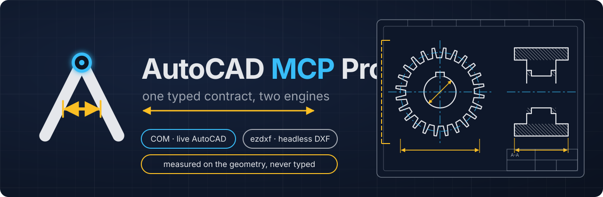
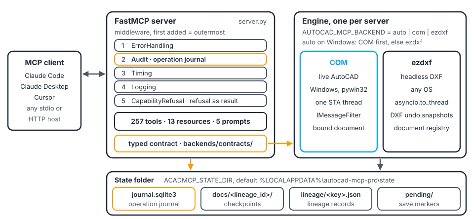
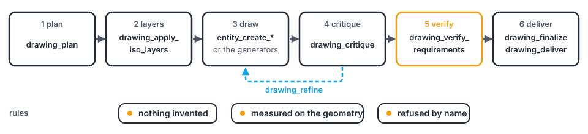

<div align="center">

# AutoCAD MCP Pro

**Production-grade AutoCAD automation for AI agents.**
Live through COM on Windows, or headless through ezdxf anywhere — one typed contract, two engines.

[](https://x.com/UEdizaslan)
[](https://discord.gg/5yjk9Bb5N)
[](https://github.com/U-C4N/Autocad-MCP/actions/workflows/ci.yml)
[](https://pypi.org/project/autocad-mcp-pro/)
[](https://pypi.org/project/autocad-mcp-pro/)
[](https://github.com/U-C4N/Autocad-MCP/blob/main/pyproject.toml)
[](https://github.com/U-C4N/Autocad-MCP/blob/main/LICENSE)

[Install](#install) · [What's new](#whats-new-in-18) · [Gallery](#what-it-draws) · [Tools](#what-you-get) · [Engines](#the-two-engines) · [Verification](#the-verification-workflow) · [Evidence](#evidence) · [Limits](#what-this-release-is-bad-at) · [Config](#configuration) · [Changelog](https://github.com/U-C4N/Autocad-MCP/blob/main/CHANGELOG.md)



</div>

> **v1.8 release snapshot:** 257 tools · 13 resources · 5 prompt templates · 7583 collected tests.
> 257 is the **registered** count. Since 1.8.0 a default install lists six over `tools/list`
> (`DISCOVERY_MODE=search`: `search_tools`, `describe_tool`, `call_tool` and the three
> `DISCOVERY_PINNED` tools), and every tool the profile and packs allow stays callable by name;
> `DISCOVERY_MODE=off` lists 253: the 252 a default profile enables (`ENABLE_3D` unset hides the five
> solids) plus `describe_tool`. `system_about` is the runtime authority.

## What's new in 1.8

1.7 made what the server draws provable. 1.8.0 makes it **remember**, finish a job in **one call** and **measure itself honestly** ([design](https://github.com/U-C4N/Autocad-MCP/blob/main/docs/superpowers/specs/2026-11-03-v1.8.0-design.md)). The new tools are `entity_modify_where`, `layer_rename`, `layer_merge`, `checkpoint_create`, `checkpoint_list`, `checkpoint_restore`, `drawing_history`, `mech_part_revise` and `pid_project`, and the new resources `autocad://critique/focuses` and `autocad://pid/project/last`; the counts are in the release snapshot above, and `system_about` is the authority.

| | What 1.8.0 adds |
|---|---|
| **It remembers** | The operation journal is durable by default (sqlite in `ACADMCP_STATE_DIR`): a reopened file continues its `document_id` and revision, a client operation id replays after a restart, and headless `drawing_undo` steps back to the newest checkpoint, also after a restart. `checkpoint_create` / `checkpoint_list` / `checkpoint_restore` keep stored states; live, `mode="in_place"` is refused with capability `checkpoint_restore_in_place` and `new_document` opens the checkpoint instead. `drawing_history` finds the value a drawing had in round 2 in two calls after a restart. Every headless DXF write is atomic, and `drawing_open(path, recover=True)` reads a damaged DXF into a new lineage whose source is protected (`recovered_source_protected`) |
| **One call, not hundreds** | `entity_modify_where` is QSELECT + CHPROP with a dry run, `layer_rename` renames every reference, `layer_merge` is LAYMRG, and `dimension_auto(selector=...)` dimensions a whole part. Measured task cells: a layer clean-up in 2 calls (1.7.0: 124) and a plate's dimensions in 2 (1.7.0: 89). A `cad_batch` that writes is all or nothing by default, and a literal handle that names no entity refuses the whole batch before anything runs (`unknown_handle`) |
| **Six tools listed, every tool callable** | `DISCOVERY_MODE=search` is the default: `search_tools`, `describe_tool`, `call_tool` and the pinned `cad_batch`, `drawing_info` and `entity_list` cost **1,026** prompt tokens idle, against 59,138 for the full `DISCOVERY_MODE=off` list. A description over 800 characters is listed short, with `Details: describe_tool.`; the whole text is one call away ([table below](#why-this-exists)) |
| **One error envelope** | Every error on every route is `{ok: false, kind, category, retryable, hint, operation_id, ...}`, typed by exception class and never by message text; the text content is what a 1.7 client read. A missing handle, path, command or file has its own kind (`not_found`, `unknown_handle`, `file_not_found`, ...). A failed `drawing_finalize` returns its `score`, `blocking` rows and `qa_coverage`, so no second QA read is needed |
| **QA that names what it did not check** | Every critique lane writes `checked` or `not_checked` with a reason, and `qa_coverage` carries them into finalize, delivery and the manifest. The `dimension_truth` focus judges a dimension by the text the sheet really shows (`dim_override_disagrees`, `dim_render_stale`, `dim_value_hidden`, ...), and `property_override` reports entities that override their layer. A lineweight of -3 is *Default*, never ByLayer. With `summary=True` a 500-issue critique is answered in 735 characters |
| **Parts revised, P&IDs as projects** | `mech_part_revise` changes a drawn part by its parameters and rebuilds its views in place, keeping its handles; a hand edit refuses it (`hand_edited_tagged_entity`), and a part drawn before 1.8.0 is `model_drift` until `overwrite=True`. `pid_line_draw(route="avoid")` goes round the symbols between its ports (`no_route`, `routing_budget_exceeded`), checked by the new `pid_line_through_symbol` focus. `pid_project` checks off-page links, cross-sheet tags and line continuity over a set of sheet files without modifying any; a `.dwg` sheet is read only on the live engine and refused headlessly with capability `dwg` |
| **DWG opens headlessly** | `drawing_open` on a `.dwg` converts it through the ODA File Converter, then AutoCAD's `accoreconsole`. With neither it is a typed capability refusal (`dwg_read`); when every route fails it is `dwg_conversion_failed` with its `attempts[]`. A save onto the `.dwg` is still refused (`dwg`): save it as `.dxf` |
| **Narrowed on request** | `READ_ONLY`, `TOOL_ALLOWLIST` / `TOOL_DENYLIST` and `MAX_TOOL_COST` refuse a call before anything runs (`policy_refused`). A writer takes only its own extensions and never a name AutoCAD or Windows loads (`path_refused`). The HTTP transport refuses an unknown Origin (403), a foreign Host (421) and a body over 8 MiB (413). `system_run_lisp` runs an AutoLISP read tier under `LISP_POLICY=read` (COM only: the headless engine has no LISP) |
| **The live engine draws where it means to** | A live seat draws in model space until `layout_set_current` names a sheet; the tab the operator clicks no longer moves it. `system_run_command` and live undo / redo wait for the command and can fail `command_incomplete`. One display refresh per COM job, and `entity_batch_create` / `entity_delete_many` run as STA jobs sliced at a quarter of `COM_CALL_TIMEOUT`. All fourteen live smokes passed for this release (AutoCAD 2026, 1.8.0): see *Live evidence* in the [changelog](https://github.com/U-C4N/Autocad-MCP/blob/main/CHANGELOG.md) |
| **Four tracker reports, fixed the same day** | `view_screenshot` captures the whole AutoCAD window at any display scaling, not the top-left 2/3 at 150 % (#17); `page_setup_apply` takes the device's full-bleed and expanded media, `ISO_full_bleed_A3_(420.00_x_297.00_MM)` or `bleed="full_bleed"` (#18); `CAD_LAUNCH=never` keeps the live engine to the session you opened, and a launch that never accepts `Visible` is quit, not left windowless (#19); a live `entity_get` on a DIMENSION / HATCH reuses one `Document.Export` for `COM_SNAPSHOT_TTL` seconds instead of exporting the drawing per call (#20). *Issues fixed from the tracker* in the changelog says what each one measured |
| **Evidence** | Correctness suite 83 / 83 against v1.7.0's 61 / 83, 22 fixed and 0 regressed (`ab-v1.7.0-vs-v1.8.0.json`). Matrix v9: 47 / 47 attempted tasks of 49 (`lisp_read_tier` `environment_blocked`, `std_tables_b40` `not_run`). The full headless suite: `7582 passed, 1 xfailed`. The headless performance gate against v1.7.0: `ok: true`, ratios 0.96 to 1.06 ([`perf-v1.7.0-vs-v1.8.0.json`](https://github.com/U-C4N/Autocad-MCP/blob/main/benchmarks/results/published/perf-v1.7.0-vs-v1.8.0.json); the 1.06 is the durable journal, [measured](https://github.com/U-C4N/Autocad-MCP/blob/main/benchmarks/README.md)). The token budget gate exits 0 ([evidence](#evidence)) |

### One call where 1.7 needed hundreds

```text
drawing_open(path)                                 the journal continues the file's id and revision
entity_modify_where(where, set, dry_run=True)      count, would_change and a preview
cad_batch(steps, expected_revision=...)            all or nothing; a missing handle refuses the batch
dimension_auto(selector={"layer": "GEOMETRY"})     a part dimensioned in one call
drawing_critique(focus=None, summary=True)         compact; qa_coverage names every lane not checked
drawing_history(handle=..., detail="args")         what a value was in round 2, after a restart
checkpoint_restore("cp-3", mode="new_document")    back to a stored state, as its own document
```

Several defaults changed. Each has a switch back to 1.7.0's behaviour where one exists (`DISCOVERY_MODE=off`, `cad_batch(on_error="stop")`, `JOURNAL_DURABLE=off`, `LISP_POLICY=denylist`, `strict_critique=False`, `COM_REFRESH_MODE=regen`, ...), and the changelog's *Breaking at a glance* lists every one. Not in 1.8.0: no B40 feature-table row is transcribed (every size is still refused by name), and the native .NET worker is deferred to 1.9.0 by a rule fixed before any measurement (`docs/adr/0001-native-worker.md`).

Earlier releases, 1.7 and 1.6 included, are in the [changelog](https://github.com/U-C4N/Autocad-MCP/blob/main/CHANGELOG.md).

## What it draws

<div align="center">


<sub><b>Not a mockup.</b> Every line on this A3 sheet was drawn by the tools this server exposes — an ISO 5457 frame with zones, involute gear geometry (m6, z24), a DIN 6885 keyed bore, the section A-A cut along the keyway with hatched faces, centre lines, an ISO 128-40 cutting plane, an Ra 1.6 surface-texture symbol, six ISO 129 dimensions with the bore at <code>Ø40 H7 +0.025 / 0</code> from the ISO 286 tables, an ISO 7200 title block and a revision row — then rendered headlessly by <code>view_render</code>. <code>drawing_critique(focus=None)</code> returns <b>0 issues</b> and the finalize gate scores it <b>100</b> (grade A) over 176 entities. Rebuild it with <code>python scripts/render_readme_showcase.py</code>.</sub>

</div>

<table>
<tr>
<td width="33%" valign="top">

<br>
<sub><b>A mechanical sheet, gated.</b> A flange coupling from two part models: <code>mech_part_draw</code> draws the hub's end view and the keyed shaft, <code>mech_view_add</code> adds the hatched section A-A, and the four M12 clearance holes are a <code>mech_hole_pattern</code> on a Ø110 pitch circle. Every diameter sits on its own station — bore <code>Ø40 H7</code>, boss Ø70, flange Ø140, shaft <code>Ø40 k6</code> — with ISO 21920-1 surface-texture symbols on the machined seats. The four ISO 4014 M12×60 bolts and four ISO 4032 nuts are blocks that carry XDATA, so the ISO 7573 parts list (2 rows, 4 each) is read off the drawing and its balloons are linked to them. <code>drawing_critique(focus=None)</code> returns <b>0 issues</b> and <code>drawing_finalize</code> scores it <b>100</b> (grade A) over 253 entities. Rebuild it with <code>python scripts/render_readme_mech.py</code>.</sub>
</td>
<td width="33%" valign="top">

<br>
<sub><b>A floor plan whose areas nobody typed.</b> An A2 apartment plan at 1:50, rendered from its paper layout. One <code>arch_plan_from_spec</code> transaction draws a 250 mm brick ring, splits it into five rooms with 100 mm AAC partitions, hosts five doors and five windows in their walls, adds a straight stair and sets out the door, window and room schedules as tables. The engine measured each room off its wall faces — living 19.27 m², bedroom 13.99 m², 57.20 m² in total — and no area was typed. <code>arch_grid</code>, <code>arch_dimension_chains</code>, <code>arch_symbol</code> (north arrow, section marks) and 15 catalogue blocks finish it. <code>drawing_critique(focus=None)</code> returns <b>0 issues</b> and the finalize gate scores it <b>100</b> (grade A). Rebuild it with <code>python scripts/render_readme_arch.py</code>.</sub>
</td>
<td width="33%" valign="top">

<br>
<sub><b>The same server as a P&ID drafter.</b> <code>pid_from_spec</code> drew this A3 feed-and-reaction sheet in one transaction, routed round every symbol (<code>routing: "avoid"</code>): a feed tank, two centrifugal pumps, a shell-and-tube cooler, a reactor, three ISA-5.1 control loops with diaphragm valves, two pressure gauges and four off-page connectors. Then <code>pid_graph</code> read the sheet back: 21 nodes, 19 edges, 0 dangling ends, <code>confidence_min</code> 1.0. <code>drawing_critique(focus=None)</code> returns <b>0 issues</b> and the finalize gate scores it <b>100</b>. Rebuild it with <code>python scripts/render_readme_pid.py</code>.</sub>
</td>
</tr>
</table>

<div align="center">


<sub><b>The catalogue, authored in code.</b> 43 ISO 10628-2 / ISA-5.1 symbols: 11 valve bodies × 6 actuators, 6 rotating machines, 4 heat exchangers, 6 parametric vessels, 7 inline items, the instrument bubble in 4 types × 5 locations, 5 line markers and 3 connectors. Every one was placed through <code>pid_symbol_insert</code>'s own path. Rebuild it with <code>python scripts/render_pid_catalog.py</code>.</sub>

</div>

## Why this exists

<details>
<summary><b>Why six tools are listed, and what the whole catalog costs</b></summary>

**A big MCP server is expensive to be connected to.** Listing the whole catalog (`DISCOVERY_MODE=off`, 253 tools) costs a client **59,138 tokens** of prompt payload before it has asked for anything. Since 1.8.0 a default install lists six tools instead - `search_tools`, `describe_tool`, `call_tool` and the three `DISCOVERY_PINNED` tools - for **1,026 tokens**, and every tool stays callable by name.

**A drafter searches for `FILLET`, not `entity_fillet`.** Before the corpus, those command names appeared in no tool name or description. That was `df = 0` against a stock index: the tools were not ranked badly, they were *absent*. The fix was data: an authored corpus of **207 AutoCAD command names and 1,479 distinct synonym phrases** covering all 257 registered tools. A test refuses to let a tool exist without one.

| Advertised surface | Tools listed | Prompt payload | Wire (`tools/list`) | 1.7.0 prompt payload | 1.7.0 wire |
|---|---:|---:|---:|---:|---:|
| `DISCOVERY_MODE=search` (default since 1.8.0, with the three pins) | 6 | **1,026** | 1,300 | — | — |
| `DISCOVERY_MODE=search`, `DISCOVERY_PINNED=""` | 3 | **220** | 230 | 455 | 503 |
| `DISCOVERY_MODE=off` (`TOOL_PROFILE=full`) | 253 | 59,138 | 78,391 | 62,471 (243 tools) | 89,350 |
| `DISCOVERY_MODE=off`, `TOOL_PACKS=core,mech` | 207 | 46,767 | 62,425 | 47,955 (198) | 69,391 |
| `DISCOVERY_MODE=off`, `TOOL_PACKS=core,arch` | 204 | 44,901 | 60,289 | 46,679 (196) | 67,974 |
| `DISCOVERY_MODE=off`, `TOOL_PACKS=core` | 192 | 40,722 | 55,169 | 41,902 (184) | 61,546 |
| `DISCOVERY_MODE=off`, `TOOL_PROFILE=lean` | 68 | 16,182 | 21,189 | 17,945 (66) | 25,146 |
| Server instructions (the longest text the builder writes) | — | 199 | 199 | 461 | 461 |

> [!NOTE]
> Measured on the 1.8.0 release tree with `python -m benchmarks.token_suite` (idle lane, over the real in-memory server; [`token-cost.json`](https://github.com/U-C4N/Autocad-MCP/blob/main/benchmarks/results/published/token-cost.json)). The 1.7.0 columns are the v1.7.0 tag measured the same way with this release's lock (`benchmarks/token_budget.json`, `v1.7.0_measured`); 1.7.0's own README quoted the wire column on its older lock (89,226 / 61,422 / 25,066 / 503). Tokens are offline ratio estimates, not tokenizer counts, and they are the *uncached* cost: prompt caching amortises the idle term. The prompt payload is the `tools` array a client forwards to the model; the wire column is the whole `tools/list` result, the basis of every figure up to 1.7.0. In `off` mode the list carries `describe_tool` too, and a description over 800 characters is listed as its leading paragraphs plus `Details: describe_tool.`, the full text one `describe_tool` call away. `benchmarks/token_suite.py --tokenizer anthropic` counts for real.

</details>

## Install

```bash
pip install autocad-mcp-pro     # or: uvx autocad-mcp-pro
autocad-mcp                     # stdio MCP server, backend auto-selected
```

```bash
AUTOCAD_MCP_BACKEND=ezdxf autocad-mcp    # portable DXF engine, no AutoCAD needed
AUTOCAD_MCP_BACKEND=com   autocad-mcp    # live AutoCAD (needs the [com] extra)
```

| Extra | Pulls in | For |
|---|---|---|
| *(none)* | `fastmcp`, `ezdxf`, `pydantic` | Headless DXF on any OS — **no rendering** |
| `[com]` | `pywin32`, `Pillow` | Live AutoCAD control + window capture |
| `[pdf]` | `matplotlib` | PDF export and headless PNG, any platform |
| `[office]` | `openpyxl` | XLSX workbooks (takeoffs, `data_extract`); CSV is always written |
| `[full]` | everything above | Development and CI |

> [!NOTE]
> The bare install **cannot draw pixels** — `ezdxf.addons.drawing` imports Pillow unconditionally, so every render path needs it. Add `[pdf]` for images on Linux or macOS.

### As a Claude Code plugin

The server and the premium skill install together. The skill teaches the measured workflow: requirements → geometry → verified on the CAD → saved → reopened → delivered.

```bash
claude plugin marketplace add U-C4N/Autocad-MCP
claude plugin install autocad-mcp-pro@autocad-mcp
```

The plugin runs `uvx --from "autocad-mcp-pro[com,pdf,office]==1.8.0" autocad-mcp`, which is this release at exactly the plugin's version, so it needs [uv](https://docs.astral.sh/uv/). Set `AUTOCAD_MCP_SOURCE` to a checkout (`C:/path/to/Autocad-MCP[com,pdf,office]`) to run that code instead. The plugin starts the server in search mode (`DISCOVERY_MODE=${AUTOCAD_MCP_DISCOVERY:-search}`); set `AUTOCAD_MCP_DISCOVERY=off` for the full catalog. Already running the server yourself? Keep one: turn the plugin's server off in `/mcp`, or copy `.claude/skills/autocad-mcp-premium/` into your `.claude/skills/` instead. [`plugin/README.md`](https://github.com/U-C4N/Autocad-MCP/blob/main/plugin/README.md) has the details.

<details>
<summary><b>Wire it to an MCP client</b></summary>

```json
{
  "mcpServers": {
    "autocad": {
      "command": "autocad-mcp",
      "env": {
        "AUTOCAD_MCP_BACKEND": "auto",
        "ALLOWED_PATHS": "C:\\Users\\you\\Documents\\AutoCAD",
        "TOOL_PROFILE": "full",
        "TOOL_PACKS": "all",
        "DISCOVERY_MODE": "search"
      }
    }
  }
}
```

It works with Claude Desktop, Cursor, or any stdio MCP host. For HTTP, run `autocad-mcp --transport http --port 8000`. It binds loopback only, unless remote HTTP is explicitly enabled **and** a bearer token is set.

</details>

## What you get

| Area | What it does |
|---|---|
| Drawing lifecycle | create, open (a damaged DXF with `drawing_open(recover=True)`, which reports every fix and protects the source; a DWG headlessly through the ODA File Converter or AutoCAD's `accoreconsole`), save *(atomic headlessly: a checked temporary file renamed over the target)*, export DXF/PDF, audit *(repairs)*, purge, undo/redo *(reporting `verified`)*. A reopened file continues its document id and revision; a file changed outside the server says `external_change`, and one the server ended before saving says `lost_since_save` |
| Durability & history | headless, every save, open, new drawing, rollback batch and `checkpoint_create(label)` keeps a gzip checkpoint in `ACADMCP_STATE_DIR`; live AutoCAD keeps one only at `checkpoint_create`, at each `transaction_begin` and before `entity_delete_many` / `drawing_purge` / `text_find_replace` - not at a save, an open or a new drawing. The headless `drawing_undo` steps back to it **after a restart too** (`granularity` save / batch / label). `checkpoint_list` / `checkpoint_restore(mode="in_place"\|"new_document")` (an in-place restore is itself undoable; live AutoCAD restores as a new document). `drawing_history(label=, handle=, query=, detail=)` reads what was done to the drawing, with which arguments, across restarts: label a round with `_meta.label` or `cad_batch(label=)`, then read its value back in two calls. `drawing_diff(old_checkpoint=, new_checkpoint=)` compares checkpoints, with feature-payload and dimension-measurement changes |
| Geometry | lines, arcs, polylines (with `bulges`), splines, hatches, trim/extend/fillet/chamfer, handle-preserving edits: `entity_edit_geometry` moves circle, line and arc geometry, rewrites a polyline's `points` / `bulges` (the vertex count may change) and moves a TEXT/MTEXT by `x` / `y`; `entity_edit_text` edits content, height, rotation and position |
| Set-based edits | `entity_modify_where(where, set)` restyles every entity a filter matches in one call (QSELECT + CHPROP: layer globs, type, colour, linetype, lineweight, region, block); `dry_run` returns the count, the first 20 handles and a `preview`, and an `expect_count` the drawing no longer matches is refused `stale_revision`. `layer_rename` renames a layer and every reference to it; `layer_merge` (LAYMRG) moves the sources' entities in model space, every sheet and every block definition onto a target and names the block definitions it touched. Entities on locked layers are skipped and reported |
| Annotation | ISO 129 toleranced dimensions, ISO 286 fits (`fit="H7"`, interference shafts r/s/t/u included), TABLE, MLEADER, GD&T frames and datums (ISO 1101). `dimension_auto(selector={"layer": "GEOMETRY"})` dimensions a whole part in one call - polyline edges per side, hole diameters, arc radii, the overall size - with `include`, `group_equal` (`6× Ø11`), `skip_existing` (on by default: a rerun draws nothing) and `dry_run`; whatever it cannot dimension is listed in `omitted` with its reason. A headless `dimstyle_modify` redraws the dimensions using the style (`rerender=False` leaves them stale, as 1.7 did) |
| Engineering generators | involute gears (front + section A-A), DIN 6885 keyed bores, ISO A3 title block |
| Mechanical parts | one part model (segments or outline + typed features) and one view engine: front / side / top / section / detail with hidden lines, ISO 128-50 cut faces and ISO 129 dimensions. ISO 4014/4017/4032/7089/4762 fasteners and ISO 15 bearings insert as real blocks with attributes. `mech_part_revise(part_id, changes)` changes a drawn part's parameters by path (`{"features.bore.diameter": 24}`) and rebuilds its views in place, keeping the handles of the lines, circles and arcs it edits; a hand-edited tagged entity or a part drawn before 1.8.0 is refused unless `overwrite=True`, and each revision joins a model history that travels with the file (`mech_part_inspect(history=True, param=...)`, `drift=True` for what no longer matches the model). DIN 471/472, DIN 509, DIN 332 and ISO 3601-2 features have their drawing code and, since 1.8.0, a double-entry transcription pipeline, but *their tables still ship empty* (see [limits](#what-this-release-is-bad-at)). Also ISO 21920-1 surface texture, ISO 2553 welds and ISO 128-40 section lines |
| Sheet & delivery | ISO 5457 frames A4-A0 with zones and trim marks, ISO 7200 title blocks for every size, revision blocks with clouds, ISO 7573 parts lists with ISO 6433 balloons linked by XDATA, CSV/XLSX extraction, xrefs and images on both engines, real `.dwg` on a live seat |
| Architecture | one plan model (walls with hosted doors and windows) and one engine that resolves L / T / X junctions, cuts openings and draws poché by material. Room areas are measured from the faces the walls enclose, never typed, and rooms are read back from any plan with a confidence. Door / window / room schedules are real TABLEs. Also a furniture and sanitary catalogue at nominal sizes, a structural grid, north arrow, section / level / elevation marks, exterior dimension chains, and English or Turkish labels (`lang="tr"`, decimal comma) |
| Understanding & takeoffs | `drawing_understand` reads a drawing somebody else made in one call: declared vs inferred units, robust extents and the outlier behind them, plan copies, each layer's discipline and service in five languages, tags, rooms. `drawing_scale_check` says whether a P&ID is to scale against its layout. `pipe_takeoff` / `cable_takeoff` take the topology from the P&ID and the lengths from the layout (rectilinear MST, statuses A/B/C, power never invented) into a Turkish / English / Russian workbook. `drawing_diff` compares revisions; `drawing_topology_check` finds dangling ends, near misses and crossings |
| P&ID | catalogue blocks with ports and tags (ISO 10628-2 / ISA-5.1), port-to-port lines with ISA-5.1 classes and line numbers, `pid_graph` reads any P&ID back with confidence, instrument index / line list / equipment list, `pid_from_spec` one-call sheets. An `avoid` line (`pid_line_draw(route="avoid", clearance=, keep_out=)`, `pid_from_spec`'s `sheet.routing: "avoid"`) goes round the vessels between its ports, and `obstacle_hits` / the `pid_line_through_symbol` focus say when a line does not. `pid_project` checks a project of several sheet files without modifying any: off-page links matched across files, cross-sheet duplicate tags, line-number continuity, and the three lists merged with a `sheet` column (last result: `autocad://pid/project/last`) |
| Styles & standards | ISO-25 / ANSI dimension styles, ISOCP / ROMANS text styles, ISO / ANSI leader styles from authored presets; `drawing_apply_standard("iso")` sets all of it plus units and the `mech` layers in one call; `changed` reports only what moved |
| Discovery | the default since 1.8.0 (`DISCOVERY_MODE=search`): a client lists `search_tools`, `describe_tool`, `call_tool` and the `DISCOVERY_PINNED` tools (`cad_batch`, `drawing_info`, `entity_list`), and can still call every tool by name. `search_tools` is ranked over an AutoCAD command and synonym corpus — `FILLET`, `BPOLY`, `QSELECT`, `WBLOCK`, `OVERKILL`, `CHSPACE` each rank **#1** among the 252 tools a default install searches (the v9 `tool_discovery` task); `describe_tool` returns one hit's full input schema, risk, pack and its docstring's own examples, or up to 25 with `names=[...]`. The server instructions name only the tools the client can see and teach batching first |
| Batching | `cad_batch` runs a step list in one round trip and, since 1.8.0, is all or nothing by default (`on_error="auto"`: a batch that writes is rolled back on a failure; `on_error="stop"` keeps the steps before it). A literal handle that names no entity refuses the whole batch before anything runs (`unknown_handle`); the result carries `changes` {added, deleted, counts} and `label=` names it in the history. `entity_delete_many` deletes all of its handles or none. `fields=` projects 11 result-heavy tools |
| Paper space | tab lifecycle, viewports, `entity_change_space` (CHSPACE), `drawing_export_pdf(layout=…)` |
| Page setup & templates | ISO 216 / ANSI Y14.1 sheets, ctb catalog, `page_setup_apply` on both engines (`paper` also takes a canonical media name exactly as AutoCAD spells it, e.g. `ISO_full_bleed_A3_(420.00_x_297.00_MM)`, or a catalogue paper with `bleed="full_bleed"` / `"expand"`; the name's numbers fix the sheet size and orientation, a contradicting `orientation` is refused, and on a live seat a media the device does not list in `GetCanonicalMediaNames()` is refused with its three closest names, #18), and `batch_plot` with every sheet size read back from its PDF's `/MediaBox`. Five bundled templates, built by the server's own tools and pinned reproducible: `drawing_new(template="iso_a3_mech")`, `iso_a1_arch`, `iso_a3_pid`, `ansi_b_mech`, `ansi_d_arch`. Save any drawing as a template (`.dwt` on live AutoCAD; `dwt_write` refused headlessly) |
| Environment | several open documents headlessly, portable layer states (`ACADMCP_LAYERSTATES` XRECORDs — in the file, not in AutoCAD's Layer States Manager), named views, UCS *(tool coordinates stay WCS)*, a system-variable catalog with ranges, document properties. On a live seat: launch/attach, preferences, and an operator prompt / pick / select, where ESC is `cancelled`, not an error |
| Selection | window vs crossing stated back to the caller; a polygon tested against its own shape, not its bounding box |
| Boundaries | `boundary_trace` (BOUNDARY/BPOLY) chains loose edges into one closed polyline, arcs kept as bulges *(headless)* |
| Measurement | `analysis_measure_entity` measures what is *in* the drawing, by handle |
| Hatch depth | gradients, in-place edits, typed edge boundaries *(headless)*, island styles |
| Annotation objects | WIPEOUT, REVCLOUD, MTEXT background masks *(headless)*, text find/replace |
| 3D solids | `solid_box/cylinder/extrude/revolve/boolean` on live AutoCAD (`ENABLE_3D=true`) |
| Quality loop | `drawing_preflight` → `drawing_plan` → `drawing_critique` → `drawing_refine` → `drawing_finalize` (0–100 score); the general focuses (`iso128`, `layer_color`, `dim_overlap`, `untrimmed_corner`, `duplicate_entities`, `construction_left`, `property_override` (an entity on an engineering layer that overrides the layer's lineweight, colour or linetype; `drawing_refine` sets it back to ByLayer), `dimension_truth` (a DIMENSION whose override, DIMLFAC, rendered block, group 42, prefix or visibility disagrees with its geometry or its style; `drawing_refine` redraws a stale block and leaves the lies to a person), `gdt`) plus 20 domain critique focuses (P&ID 7 - with `pid_line_through_symbol`, a line through a symbol that is not its end - mechanical 7 - with `model_drift`, a drawn part whose tagged entities or views no longer match its stored model - architecture 3, topology 3), each silent on a drawing outside its domain; `autocad://critique/focuses` lists every one with what it reports. Every check reads every entity of every space, and a check that fails says so. Every check also says what it looked at: `drawing_critique(report=True)` returns the coverage per layout, and `drawing_finalize` / `drawing_deliver` carry `qa_coverage`, naming each lane that was **not** checked and why (`no_viewport_scale`, `engine_live_document_template`, ...); `strict_critique=True` fails on those. `drawing_critique`, `validation_check` and `drawing_topology_check` take `summary` / `limit` and answer `{total, by_focus, by_severity, issues[:limit]}`, `total` always complete. A failed `drawing_finalize` returns its `score` and `blocking` rows (`detail="full"` for all of them) |
| Verification | `drawing_verify_requirements` binds typed source requirements to the real features (handle, feature tag, geometry or DIMENSION) and measures them on the drawing or on a saved file: distance, radius, diameter, angle, concentric, parallel, perpendicular, tangent, counts and absence, each **pass / fail / unknown / unsupported / ambiguous** with its evidence, as JSON or Markdown. The set can be stored in the drawing itself |
| Delivery | `drawing_deliver`: DXF/PDF/PNG + SHA-256 manifest, reopen parity against a second export over every space and block definition (its `scope` says what that can and cannot see), and with `requirements=` every requirement measured again on the reopened file; the open document is never re-pointed at the export |
| Safe edits | documents carry an id and a content revision; `cad_batch` / `drawing_refine` / `text_find_replace` / `pid_from_spec` preview exactly and apply only against an unchanged revision; a client operation id replays a retried call instead of repeating it, also after a restart (the journal is durable, in `ACADMCP_STATE_DIR`) |
| Errors | every failure on every route is one typed envelope: `{ok: false, kind, category, retryable, hint, tool, backend, operation_id, message}` beside the unchanged sentence. `retryable` is true only when nothing was written; a refused raw command lists the typed tools that do the same job (`alternatives`) |
| Security | `READ_ONLY`, `TOOL_ALLOWLIST` / `TOOL_DENYLIST` and `MAX_TOOL_COST` narrow what a client may reach: a refused tool is not advertised, and a call to it - direct, through `call_tool`, or as a `cad_batch` step - is refused `policy_refused` before anything runs (`system_status.policy` says what is in force). Every writer accepts only its own extensions and none writes a file AutoCAD or Windows loads (`acad*.lsp`, `.fas`, `.scr`, `.dll`, `acad.pgp`, ...), even inside `ALLOWED_PATHS`. Over HTTP, an unknown Origin is 403, a foreign Host 421, a body over 8 MiB 413, tokens are compared in constant time, and `MCP_AUTH_TOKEN_READONLY` issues a read-only token. `system_run_lisp` runs the AutoLISP read tier (`vla-get-*`, `entget`, `mapcar` over a `lambda`, ...) under `LISP_POLICY=read`, and refuses the rest with `symbol`, `line`, `column` and the typed `alternatives` |
| Session metrics | `system_status(metrics=True)` reports this connection's calls, `by_tool`, `result_bytes`, `errors_by_kind` and p50 / p95 ms, and on a live seat each COM job's queue / guard / work / refresh / counter ms; off by default. `system_status.operations` is a short summary (`{count, last, unknown_commit}`); `drawing_history` lists the calls |
| Live speed | the live engine refreshes the display once per COM job (`Update()` of the entity for a single create, one Regen otherwise; `COM_REFRESH_MODE=regen` for a seat where `Update()` does not paint), `entity_batch_create` / `entity_delete_many` run as one STA job sliced inside `COM_CALL_TIMEOUT`, and the corner operations read only the target block's new entities. `benchmarks/perf_com.py` measures it against v1.7.0 on a live seat: on AutoCAD 2026 three of its four targets are missed (see *What this release is bad at*) |

<sub>257 tools in 28 groups. <code>TOOL_PACKS=core</code> hides these from a client that needs none of them: the ten <code>pid_*</code> tools, the 22 environment tools, the 15 mechanical tools, the 12 architectural tools and the two plant takeoffs. <code>TOOL_PACKS=core,mech</code> keeps the mechanical ones, <code>TOOL_PACKS=core,arch</code> the architectural ones, and <code>TOOL_PACKS=core,plant</code> the takeoffs. There are also 13 resources that cost nothing in the tool budget (<code>autocad://drawing/info</code>, <code>layers</code>, <code>blocks</code>, <code>entities/stats</code>, <code>entities/{layer_name}</code>, <code>system/status</code>, <code>pid/symbols</code>, <code>pid/project/last</code>, <code>standards/isa51</code>, <code>standards/coverage</code>, <code>critique/focuses</code>, and the task recipes <code>recipes/index</code> and <code>recipes/{recipe_id}</code> - seven recipes, among them <code>layer_cleanup</code> and <code>dimension_part</code>, each one <code>cad_batch</code>) and 5 prompt templates.</sub>

**Three rules worth knowing.**

- Every coordinate in and out of a tool is WCS on both engines. The one exception is TEXT `rotation`, which stays in the entity frame: a mirrored TEXT is mirror-imaged, and no scalar angle expresses that.
- Never read vertices back and shoelace them. That silently loses **28.2%** of the area on a semicircular edge. `analysis_measure_entity(handle)` reads the real geometry and states its own accuracy.
- A lineweight of **-3 is Default** (the LWDEFAULT setting), not ByLayer: ByLayer is -1 and ByBlock -2. Every lineweight input also takes the names `"ByLayer"`, `"ByBlock"` and `"Default"`, a layer refuses ByLayer and ByBlock by name, and entity rows carry `lineweight_name`.

## The two engines

<div align="center">

<picture>
  <source media="(prefers-color-scheme: dark)" srcset="https://raw.githubusercontent.com/U-C4N/Autocad-MCP/main/docs/assets/architecture-dark.svg">
  
</picture>

</div>

One contract across 23 modules in `backends/contracts/`. `@capability(key, reason=…)` supplies a default that *refuses*, and a test holds both backends' capability key sets equal. There are **45 capability keys**. Read `system_capabilities` at runtime rather than trusting the table: several depend on what the machine has installed (matplotlib, openpyxl, the ODA File Converter).

| Capability | COM (live AutoCAD) | ezdxf (headless) |
|---|:---:|:---:|
| Live document control | ✅ | — |
| Cross-platform, no AutoCAD | — | ✅ |
| Transactions and rollback | ✅ | ✅ |
| Paper-space layouts + viewports | ✅ | ✅ |
| Viewport model-content rendering | ✅ | ✅ ᵐ *(no borders)* |
| Selection window / crossing / polygon | ✅ | ✅ |
| Entity area by handle | ActiveX `.Area` | Analytic, bulges included |
| HATCH filled area (islands subtracted) | AutoCAD's own number | Loops walked, `hatch_style` reported |
| HATCH loops and DIMENSION fields in `entity_get` | ✅ read from a `Document.Export` snapshot, which costs about as much as `drawing_understand` on a large drawing and is reused for `COM_SNAPSHOT_TTL` seconds (default 5) while the document's revision and operator-edit count stand still, so N reads of an unchanged drawing cost one export; an entity missing from the reused export is read from a fresh one; `system_status.snapshot_reuse` counts exports and reuses (#20) | ✅ |
| A session bound to its document | ✅ an active-tab switch is refused, `view_screenshot` included; a restarted AutoCAD is a new document (`application_changed`); the operator's object edits move the revision | — *only the server switches documents* |
| Where new geometry goes | model space until `layout_set_current` names a sheet; the layout tab the operator clicks never moves it | model space until `layout_set_current` |
| Raw commands | `system_run_command` waits for the command (`COMMAND_DEADLINE_S`) and reports `created` entities and `last_prompt`; a command left at a prompt is `command_incomplete` | — *refused by name* |
| REGION / 3DSOLID area | ✅ | — *ACIS is opaque to ezdxf* |
| 3D solids | ✅ *with `ENABLE_3D=true`* | — |
| DWG read | ✅ native | `drawing_open` converts it through the ODA File Converter, then AutoCAD's `accoreconsole` (`ACCORECONSOLE_PATH`), if installed; otherwise refused `dwg_read`. The opened drawing is saved as `.dxf` |
| DWG write | ✅ `SaveAs` | via the ODA File Converter, if installed |
| `.dwt` templates | ✅ | DXF only — `dwt_write` refuses |
| Reading a foreign drawing (`drawing_understand`, takeoffs) | ✅ one `Document.Export` snapshot; the document is never renamed | ✅ |
| XLSX workbooks | ✅ ᵒ | ✅ ᵒ |
| Preferences · launch · operator prompts | ✅ | — *refused by name* |
| WIPEOUT · MTEXT background colour | — *verified absent, AutoCAD 2026* | ✅ |
| REVCLOUD · BPOLY · typed hatch edges | — *no ActiveX member* | ✅ |
| CHSPACE | — *unverified on a live seat* | ✅ ᶜ |
| Undo history | ✅ AutoCAD's own; a checkpoint restores as a new document (`checkpoint_restore_in_place` refused) | durable checkpoints, also after a restart; per-call steps opt-in with `EZDXF_UNDO_DEPTH` |
| TABLE and MLEADER | Native | Portable composite |
| Screenshots and PDF | Window capture, DPI-aware: the server makes itself DPI-aware before reading AutoCAD's window rectangle, so the whole window is captured at any Windows display scaling, and the report states `dpi`, `capture` (physical pixels) and `window_minimized` (#17) | Matplotlib ᵐ |
| A region screenshot (`view_screenshot(region=[x0, y0, x1, y1], max_px=)`) | ✅ the `Document.Export` snapshot drawn by the headless renderer (`source: "export_snapshot"`) | ✅ ᵐ |

<sub>ᵐ Needs matplotlib (<code>[pdf]</code>/<code>[full]</code>). Without it, <code>png</code>, <code>pdf</code>, <code>viewport_render</code> and <code>handle_overlay</code> report unsupported headlessly.<br>
ᵒ Needs openpyxl (<code>[office]</code>/<code>[full]</code>). Without it, XLSX is refused with <code>xlsx_write</code> and CSV is still written.<br>
ᶜ Headless CHSPACE has four restrictions, named in its capability reason: top-view untwisted viewports only; dimensions refused unless frozen; ACIS, proxy and table entities refused; viewport clipping reported rather than applied.</sub>

> [!IMPORTANT]
> The COM paths run against a **live AutoCAD 2026** through eight asserting smoke scripts (`scripts/smoke_*_com.py`) on one harness (`scripts/live/harness.py`: attach only, its own documents, an active-document guard). The 1.7.0 runs passed **129 / 129** checks on the close-out commit `13499fe`; their JSON is committed under [`benchmarks/results/live/`](https://github.com/U-C4N/Autocad-MCP/tree/main/benchmarks/results/live). These runs catch what no headless test can: ActiveX refuses `entity.Layer` on a missing layer where ezdxf quietly creates it, calls a block reference `BLOCKREFERENCE` rather than `INSERT`, and, once pywin32's type-library cache exists, hands every listed entity back as a bare `IAcadEntity` with no endpoints. Each of those broke a tool that passed every headless test.

## The verification workflow

<div align="center">

<picture>
  <source media="(prefers-color-scheme: dark)" srcset="https://raw.githubusercontent.com/U-C4N/Autocad-MCP/main/docs/assets/loop-dark.svg">
  
</picture>

</div>

```text
drawing_preflight(intent, requirements)        typed items: id, quantity, target + unit, feature, source
drawing_plan(..., persist_requirements=True)   the set travels inside the DWG/DXF
mech_part_draw(spec)                           every entity tagged with its feature
drawing_verify_requirements(use_stored=True)   measured on the document: pass / fail / unknown / ambiguous
drawing_critique(focus=None)                   drafting checks over every entity of every space
drawing_deliver(..., requirements=...)         exported, reopened, measured again on the file
drawing_verify_requirements(manifest_path=)    later: has anything in the delivery changed since?
```

A drafting score is not an acceptance. `drawing_finalize` still returns its 0–100 score, but with `requirements=` a requirement that does not pass blocks it (`failed_acceptance`), whatever the score.

## Evidence

Every number here is produced by a script under [`benchmarks/`](https://github.com/U-C4N/Autocad-MCP/blob/main/benchmarks/) and published as JSON under [`benchmarks/results/published/`](https://github.com/U-C4N/Autocad-MCP/tree/main/benchmarks/results/published); [`benchmarks/README.md`](https://github.com/U-C4N/Autocad-MCP/blob/main/benchmarks/README.md) explains each lane and keeps the full tables.

83 deterministic headless checks run against the previous tag and the current tree, each in its own subprocess:

| Version | Checks passing | Pass rate | Fixed | Regressed |
|---|---:|---:|---:|---:|
| v1.7.0 *(baseline)* | 61 / 83 | 73.5 % | — | — |
| **v1.8.0** *(this release)* | **83 / 83** | **100 %** | 22 | **0** |

The task matrix v9 (49 tasks, each one able to fail) passes 47 / 47 of the tasks the headless engine attempts ([`lanes-v9/`](https://github.com/U-C4N/Autocad-MCP/tree/main/benchmarks/results/published/lanes-v9)); the headless performance gate against v1.7.0 is `ok: true` with ratios 0.96 to 1.06, the 1.06 being the durable journal's one commit per mutating call ([`perf-v1.7.0-vs-v1.8.0.json`](https://github.com/U-C4N/Autocad-MCP/blob/main/benchmarks/results/published/perf-v1.7.0-vs-v1.8.0.json)); the token budget gate exits 0 ([`token-cost.json`](https://github.com/U-C4N/Autocad-MCP/blob/main/benchmarks/results/published/token-cost.json)); and all fourteen live smokes passed on AutoCAD 2026 for this release ([`matrix.json`](https://github.com/U-C4N/Autocad-MCP/blob/main/benchmarks/results/live/1.8.0/matrix.json)). What was measured and found wanting is in the changelog's *Live evidence* and under the limits below.

## What this release is bad at

A page that only lists strengths is a page that has not been measured.

<details>
<summary><b>Measured limits, by track</b></summary>

**Headless entity creation is slower than v1.4.0, and neither 1.6, 1.7 nor 1.8 won it back.** 1.8.0 is not slower than 1.7.0 beyond the gate's noise, and 1.7.0 not slower than 1.6.0 ([measured](https://github.com/U-C4N/Autocad-MCP/blob/main/benchmarks/README.md)); the loss is 1.6's against v1.4.0, and winning it back is B10, 1.8.1. 1.8.0 adds two measured costs of its own on that path, both named above: the durable journal's commit on every mutating call, and the atomic save's fsync and verification. These are medians of five alternating runs on one machine, with one interpreter (CPython 3.11.15) and one ezdxf, v1.4.0's code against 1.6.0's ([`perf-v1.4.0-vs-v1.6.0.json`](https://github.com/U-C4N/Autocad-MCP/blob/main/benchmarks/results/published/perf-v1.4.0-vs-v1.6.0.json)):

| Workload | v1.4.0 | v1.6.0 | v1.6.0, `EZDXF_CALL_TIMEOUT=0` |
|---|---:|---:|---:|
| 2,000 lines, one call each | 244.5 ms | 306.1 ms (1.25×) | 284.9 ms (1.17×) |
| 10,000 lines: build, DXF export, reopen | 1,847.9 ms | 2,553.5 ms (1.38×) | 2,216.4 ms (1.20×) |
| Region query over 10,000 entities | 665.2 ms | 712.2 ms (1.07×) | 783.9 ms (1.18×) |
| Premium quality pass | 150.6 ms | 65.3 ms (**2.3× faster**) | 69.9 ms |

The per-call timeout stops one hung call from wedging a server whose document lock is a single `asyncio.Lock`. It explains only part of the slowdown: switched off, creation is still 1.17× and 1.20× slower. The rest is extra work per call that 1.6 has not removed. A cProfile of the event-loop thread counts 491,071 function calls for the 2,000 creates, against v1.4.0's 319,038. Earlier READMEs said that switching the timeout off returned creation to v1.4.0's numbers. Measured this way, it does not. The region-query row, which moves the wrong way, shows this machine's noise floor (about ±10 %). Roadmap criterion 7 is not met and moves to 1.7.1.

**Four mechanical feature tables ship empty.** DIN 471/472 retaining-ring grooves, DIN 509 undercuts, DIN 332 centre holes and ISO 3601-2 O-ring grooves have their drawing code and their provenance tests, but no rows. A groove diameter written from memory is a wrong workshop drawing, while a narrow table is merely narrow. So every size is refused by name until rows verified against the standard's own table are transcribed. Since 1.8.0 a row reaches the tables only through a double entry: typed twice into `engineering/mech/standards/data/<std>.a.json` and `.b.json` by two named people, with the edition, table and page, checked against physical invariants and generated into `_rows.py` by `scripts/build_standards.py` (`--check` is a gate). ISO 3601-2 is now two tables, radial static and axial, so the eight tables are DIN 471, DIN 472, DIN 509-E, DIN 509-F, DIN 332-A, DIN 332-B, ISO 3601-2 and ISO 3601-2-axial. The licensed copies were not at hand for 1.8.0, so every one of them is still empty and deferred to 1.8.1 by name.

**Undo after a restart is as fine-grained as your checkpoints.** Headless, a checkpoint is taken at a save, an open, a new drawing, a rollback batch or a transaction boundary, and at `checkpoint_create` - never per call - so `drawing_undo` after a restart steps back to the last of those, not one call. Label a point you may want back with `checkpoint_create(label)`. Redo across a restart is not kept. On a live seat a checkpoint is a `Document.Export`, taken only at `checkpoint_create`, at each `transaction_begin` and before `entity_delete_many` / `drawing_purge` / `text_find_replace` - not at a save, an open or a new drawing - and it restores only as a new document. Without a state folder (`JOURNAL_DURABLE=off`) there are no checkpoints.

**A part revision refuses what it cannot rebuild.** `mech_part_revise` refuses a part with a detail view or two views sharing a view tag, and over a hand edit of a tagged entity or a part drawn before 1.8.0 unless `overwrite=True` - which replaces the hand edit with the model. Reconciling a revision with a changed spec, and keeping a hand edit, are 1.8.1. Dimension handles change on every revision. A part drawn before 1.8.0 is an `unstamped` info issue of the `model_drift` focus until it is revised.

**The live speed-ups miss three of their four targets.** One display refresh per COM job, bulk tools as one sliced job and owner-block reads for the corner operations are in 1.8.0, and `benchmarks/perf_com.py` measured them against v1.7.0 with targets fixed in advance (AutoCAD 2026, 1.8.0): `entity_batch_create(200)` is 2.9× faster than 200 single creates and `entity_delete_many(200)` 3.8× faster than 200 single deletes, against a target of 5× each; the single `entity_create_circle` median is 8.9 % lower, against 30 %; and the fillet time at 10,000 lines against 5,000, whose target is at most 1.2×, varies between runs on that seat (55× in the committed run, 1.19× in a run an hour earlier). A 1.8.0 fillet is still 4× to 200× faster than 1.7.0's ([`perf_com.json`](https://github.com/U-C4N/Autocad-MCP/blob/main/benchmarks/results/live/perf_com.json)). The native .NET worker is deferred to 1.9.0 under a rule written before any measurement ([ADR 0001](https://github.com/U-C4N/Autocad-MCP/blob/main/docs/adr/0001-native-worker.md)).

**Takeoffs are estimates, and they say so.**

- A layout length is the rectilinear minimum spanning tree of the tags a run connects, plus a stated vertical allowance, and it is labelled an estimate.
- A P&ID length is used only when `drawing_scale_check` calls the P&ID to scale.
- A power the P&ID does not state stays empty and becomes an open item, and no cable-section table is authored: a section comes only from your `section_rules`.
- Where no callout names a panel, the nearest panel is inferred and flagged.
- Detail copies of equipment are flagged, and excluded only when you ask.

The readers were tuned on the synthetic plant pair and on one real P&ID / layout pair that is not in this repository. Another drafting office's layer and text conventions may need vocabulary.

**Verification measures what it can bind, and says so when it cannot.** A requirement is measured on a feature it can identify: by handle, by the feature tag this server's generators write, by an architectural element, by a geometric predicate or by a DIMENSION's defpoints. On somebody else's drawing that usually means a predicate. Two equal candidates are `ambiguous`, and a spline or a tilted plane is `unsupported`. Neither is a pass, so a report full of `unknown` is a report that needs better selectors, not a clean part.

**A live revision sees the operator's object edits, not everything.** No COM event sink is used (one left the seat refusing `Documents.Add()`); a transient AutoLISP database reactor in the bound document, read through `VL.Application.16`, counts object changes, and a change since the server's previous call is one more `revision`. Measured on AutoCAD 2026: an entity added, moved, re-propertied or deleted, a layer added or changed, ERASE and U each move it by one. A view change and a system variable written with `SetVariable` do not, an edit made while a server call runs is folded into that call, and without Visual LISP the revision counts this server's writes only (`system_status.operator_edits` says which). Two counter reads per live call, 0.6-1.2 ms each (median, two runs). Two servers bound to one document each keep their own counter id, so a read by one never moves the other's revision; a write by one is an outside edit to the other. The preview's entity fingerprints still back every apply.

**The operation journal is durable, and it writes to disk.** Every call's record goes into `<ACADMCP_STATE_DIR>/journal.sqlite3` (default `%LOCALAPPDATA%\autocad-mcp-pro\state`), so a client operation id replays after a restart, and a call that was running when its server died answers `requires_reconcile` (`error_kind: "process_exit"`). By default the arguments are kept up to 4,096 bytes; `JOURNAL_ARGS=digest` keeps only their sha256, and `JOURNAL_DURABLE=off` restores the in-memory journal. A folder inside a repository checkout or beside drawings is refused, and an unusable store leaves the journal in memory with `system_status.state_store.degraded`. No call fails because of its journal, but a restart then forgets.

**A damaged DXF is recovered only when you ask, and only partly.** A file that does not parse is refused by name (`damaged_drawing`, naming `recover=True`) and the open document is kept. `drawing_open(path, recover=True)` reads it with `ezdxf.recover`, which drops what it cannot parse, not always with a fix entry: read `recovered.entities_read` before trusting the result. The recovered drawing will not save over the damaged file without `drawing_save(overwrite_source=True)`. A DWG is not recovered (`recover_unsupported`; use AutoCAD's own RECOVER).

**No Plant 3D.** The roadmap's track D (read-only queries of a Plant 3D project) was dropped: the maintainer does not use Plant 3D, and a reader tested against nobody's real projects would be a guess. Roadmap criterion 5 is withdrawn, not met.

**No REGION or 2D booleans headlessly.** `add_region()` produces a REGION with **zero ACIS bytes**, and the `greiner_hormann` substitute loses **28.2%** of the area on a square with one semicircular edge.

**`system_run_command` / `system_run_lisp` are a guardrail, not a security boundary.** The rejection message says so in those words. A 36-verb denylist refuses the obvious cases (`policy_refused`, with the typed tools for the refused verbs in `alternatives`), but AutoCAD accepts hundreds of commands, and `DANGEROUS_COMMANDS_ENABLED=true` switches the list off entirely. LISP is narrower: under `LISP_POLICY=read` (the default) a real reader runs only the AutoLISP read tier and sends everything else to the same denylist, which also re-scans every read-tier verdict; there is no write tier before 1.8.1 (`LISP_POLICY=denylist` is the 1.7 behaviour, `off` checks nothing). To take the escape hatches away altogether, `TOOL_DENYLIST=system_run_command,system_run_lisp`.

**Path validation is per-tool, and unscoped until you scope it.** With `ALLOWED_PATHS` empty (the default), the only positive bound is a ten-entry system-directory denylist that does not include `C:/Users`, `/home`, `/root` or `/var`. **Set `ALLOWED_PATHS`.**

**Non-AutoCAD ProgIDs are unverified.** `CAD_PROGID` changes which COM application the backend attaches to; nothing beyond the connection has been tested against BricsCAD, ZWCAD or GstarCAD.

**The live engine attaches to your session, or starts one.** With the default `CAD_LAUNCH=auto`, the first tool call attaches to a running AutoCAD and starts one when none runs; set `CAD_LAUNCH=never` to have the server work only in the session you opened, and it answers `cad_not_running` until you open AutoCAD (#19). The launch path itself - `Dispatch`, the `Visible` retry and the `Quit` of an instance that never comes up - is covered by fake-COM tests and was not exercised on a live seat.

### Known limitations of the P&ID track

**The default router is orthogonal and blind; `avoid` sees symbols.** `pid_line_draw` picks `auto` (still the default) from seven orthogonal candidates, by fewest bends then length:

- straight;
- one bend;
- two bends through the midline;
- a stub out of each port joined by three bends.

You can also take `direct`, or pass waypoints. Since 1.8.0, `route="avoid"` (and `pid_from_spec`'s `sheet.routing: "avoid"`) searches an orthogonal route that keeps `clearance` from every symbol that is not one of its ends and from every `keep_out` box; it refuses `no_route` naming the enclosing symbols' tags, or with `on_blocked="cross"` runs through as few blocked grid edges as it can (not always the fewest boxes) and lists them in `obstacle_hits`. Every route *counts* the existing lines it crosses (`crossings`); `avoid` adds a cost for each, but a crossing is allowed, never refused. A dense sheet can exhaust the 50,000-node search (`routing_budget_exceeded`; `pid_line_draw` does not expose the budget, so pass waypoints), a line-number label is placed after routing and is only reported when it overlaps a symbol (`label_hits`), and a per-line `avoid` inside `pid_from_spec` is refused.

**A foreign drawing is read at the confidence it earns, and no higher.** A block this server did not place classifies at 0.6, with inferred ports, by its `TAG`-style attribute or a keyword in its name. It classifies at 0.3 when a line merely touches it, and a 0.3 guess can neither raise nor suppress a critique finding.

On the live engine, an INSERT turned off a right angle has members ActiveX cannot measure, so it reports an *approximate* box. `pid_graph` takes the tighter wall of that box and the attribute-inclusive box on every side. Even so, a line ending on such a body's true edge can still be reported `dangling`, with the nearest port as the hint. Read `stats.confidence_min` first.

**Projects are read, not written.** `pid_graph` links off-page connectors within one drawing; `pid_project` (1.8.0) matches them across up to 50 sheet files, finds cross-sheet duplicate tags and line-number breaks, and never modifies a sheet. A project-wide tag sequence, and refusing a tag another sheet already holds, are 1.8.1. LINK ids are compared case-sensitively and tags case-folded. A `.dwg` sheet is read through the live backend (a headless `pid_project` refuses it; a headless `drawing_open` converts one only when ODA or `accoreconsole` is installed). There is no DEXPI/Proteus export and there are no ISA-5.2 binary-logic symbols in this release. Both cuts are recorded in the spec so nobody re-derives them.

### Known limitations of the settings track

**Layer states are ours.** `layer_state_save` writes a portable snapshot into an `ACADMCP_LAYERSTATES` XRECORD. It survives save/reopen on both engines and travels with the DWG/DXF. It is **not** an AutoCAD `LAYERSTATE` and does not appear in the Layer States Manager, which is why `system_capabilities` reports `layer_states` as `mode: "xrecord"`.

**Six of the 22 environment tools need a live seat.** Preferences, launching, the operator prompts and the five summary fields of document properties are refused headlessly with `preferences` / `dwgprops` / `live_application` / `interactive_prompt`. Each is a refusal, not a stub.

A `.dwt` template is the same case (`dwt_write`): a `.dwt` is a DWG container, so headlessly the template is saved as DXF. `mleaderstyle_create` is *not* such a case. ActiveX has no MLeaderStyle collection, but the `ACAD_MLEADERSTYLE` dictionary holds full `IAcadMLeaderStyle` objects, so both engines create leader styles.

**A dimension is redrawn on a style change, a scale and a point edit only.** Since 1.8.0, `dimstyle_modify` redraws every dimension using the style on both engines (`rerendered`; live through `Update()` and a read-back of the `*D` text), and `entity_scale` and `entity_edit_geometry` redraw the DIMENSION they change. A move, rotate, mirror, copy or array does not redraw it yet (1.8.1), and neither does a DIMENSION inside a block definition; `dimension_truth` reports a block that shows another text than its style formats as `dim_render_stale`. Headless, ezdxf 1.4.4 draws a two-line angular dimension's reflex angle, which that focus reports as not repairable here: redraw it in AutoCAD. The live redraw has not yet been run on a seat.

### Known limitations of the architecture track

**Nominal, not standard.** The furniture and sanitary blocks carry nominal catalogue sizes and say so. The stair tool reports the Blondel relation (2R + G within 600–650 mm) as a design rule, never as a building code. The `arch` layer colours are a repository convention: ISO 13567 fixes the names, not the colours. Labels speak English or Turkish; any other `lang` is refused with the list.

</details>

## Configuration

Nothing loads a `.env` file — export these, or set them in your MCP client's `env` block.

<details>
<summary><b>All 46 environment variables</b></summary>

| Variable | Default | Purpose |
|---|---|---|
| `AUTOCAD_MCP_BACKEND` | `auto` | `auto`, `com`, or `ezdxf` |
| `CAD_PROGID` | `AutoCAD.Application` | COM ProgID the live backend attaches to |
| `CAD_LAUNCH` | `auto` | Whether the live engine may start the CAD application when none is running: `auto` attaches, else starts it (and quits an instance it started that never accepts `Visible`); `never` attaches only, and the first call and `system_launch` answer `cad_not_running` instead. An unknown value stops the server at startup |
| `TOOL_PROFILE` | `full` | `lean` (67 curated tools, 57 with `TOOL_PACKS=core`) or `full` |
| `TOOL_PACKS` | `all` | Vertical packs to advertise: `core,pid,settings,mech,arch,plant` (`core` always on) |
| `DISCOVERY_MODE` | `search` | `search` (the default since 1.8.0) lists `search_tools` + `call_tool` + `describe_tool` and the `DISCOVERY_PINNED` tools, and every tool stays callable by name; `off` advertises the full catalog (the 1.7 default). An unknown value falls back to `off` with a warning |
| `DISCOVERY_PINNED` | `cad_batch,drawing_info,entity_list` | Comma-separated tools search mode lists directly, as shortened cards (full input schema; `describe_tool` returns the whole description). Empty pins nothing; a pin the profile or packs hide is not listed, an unregistered name is warned about at startup |
| `ENABLE_3D` | `false` | Expose the opt-in `solid_*` tools (COM) |
| `LOG_LEVEL` | `INFO` | Python logging level |
| `ALLOWED_PATHS` | *(empty)* | Comma-separated absolute paths the server may access |
| `MAX_UNDO_STACK` | `5` | Maximum retained undo snapshots |
| `EZDXF_UNDO_DEPTH` | `0` | Headless per-call undo steps (a full DXF snapshot per mutating call), used before the durable checkpoints; `0` leaves undo to the checkpoints |
| `MAX_DXF_BYTES` | `536870912` | Reject larger DXF input (512 MB); `0` disables |
| `MAX_QA_ENTITIES` | `2000000` | Refuse a QA read (critique, validator, finalize, deliver) of a larger drawing with `scan_incomplete`; `0` disables, a negative value is refused at startup |
| `MAX_LIST_LIMIT` | `5000` | Bound list/selection response sizes |
| `MAX_SPEC_ITEMS` | `2000` | Items per list of a `pid_from_spec` / `arch_plan_from_spec` document; `0` disables |
| `MAX_VESSEL_TRAYS` | `500` | Trays a parametric column may carry; `0` disables |
| `COM_CALL_TIMEOUT` | `60` | Per-call live AutoCAD timeout (s); `0` disables |
| `COM_SNAPSHOT_TTL` | `5` | Seconds a live `entity_get` on a DIMENSION / HATCH reuses its whole-drawing `Document.Export` (counted from when the export returned) while the document's revision and operator-edit count stand still; `0` exports on every read |
| `COMMAND_DEADLINE_S` | `8` | How long a command sent to AutoCAD's command line (`system_run_command`, live undo / redo, corner operations, the transaction mark) may stay active; past it AutoCAD's `LASTPROMPT` is read, ESC is sent three times and the call fails `command_incomplete` |
| `COM_REFRESH_UPDATE_MAX` | `1` | A live job that asked for at most this many display refreshes, each naming its entity, calls `Update()` on the last one; a larger job does one `Regen`. `0` makes every job Regen |
| `COM_REFRESH_MODE` | `auto` | `regen` forces one `Regen` per live job (for a graphics setup where `Update()` does not paint). An unknown value falls back to `auto` with a warning |
| `ACCORECONSOLE_PATH` | *(unset)* | The `accoreconsole.exe` the headless `drawing_open` converts a `.dwg` with, after the ODA File Converter. Unset uses AutoCAD 2026's installed console when it exists; `off` disables the route |
| `ACCORECONSOLE_TIMEOUT_S` | `60` | One DWG -> DXF conversion's deadline (kept inside `EZDXF_CALL_TIMEOUT`); an overrun kills the console's process tree. Must be a number above 0 |
| `EZDXF_CALL_TIMEOUT` | `120` | Per-call headless timeout (s). A read that overruns is never quarantined: until it ends, other calls on its document are refused by name (`kind: "busy"`) while `drawing_open` / `drawing_new` / `drawing_close` / `document_activate` / `document_close` and `document_list` go through without waiting for it — no restart is needed. They do not wait on its lock, but a read that computes holds Python's GIL, so the server answers slowly until it ends: an 8 s CPU-bound read at `1` s gave its own error at 5.1–5.5 s, a busy refusal in 1.2–1.8 s and `drawing_new` in 0.6–1.3 s (a read that waits on I/O answers in milliseconds). `0` disables the timeout: nothing is quarantined or detached, so a call that never ends keeps the document — every later call, the exits included, queues behind it, and only its end or a restart frees it |
| `SHUTDOWN_GRACE` | `5` | Seconds shutdown waits for a worker still inside a call before exiting without it; `0` does not wait |
| `ACADMCP_STATE_DIR` | `%LOCALAPPDATA%\autocad-mcp-pro\state` (`$XDG_STATE_HOME/autocad-mcp-pro` elsewhere) | The operation journal, pending-save markers, file lineage, durable checkpoints (`docs/<lineage_id>/cp/`) and the `accoreconsole` staging folder. A folder inside a repository checkout or one holding drawings is refused at startup and the journal runs in memory (`system_status.state_store.degraded`) |
| `JOURNAL_DURABLE` | `on` | `off` keeps the operation journal in memory only (the 1.7 behaviour: a restart forgets every operation id) and takes no checkpoints: the checkpoint tools are refused `checkpoints`, and the headless `drawing_undo` needs `EZDXF_UNDO_DEPTH` again |
| `JOURNAL_ARGS` | `bounded` | What a journal row keeps of the arguments: `bounded` (canonical JSON up to 4,096 bytes), `digest` (sha256 only; answers kept as a hash too) or `off` |
| `JOURNAL_SYNC` | `normal` | sqlite `synchronous`: `normal` loses nothing on a process kill; `full` also covers an OS crash or power loss, at about 30× the cost per commit |
| `JOURNAL_RETAIN_DAYS` | `30` | Journal rows older than this are dropped when the store opens |
| `JOURNAL_RESULT_MAX_KB` | `64` | A client id's answer above this keeps only its sha256 and replays as `result_truncated: true` |
| `CHECKPOINT_KEEP` | `20` | Checkpoints kept per drawing lineage besides its first (S0); older ones are evicted (listed with `evicted: true`, restoring one is refused `checkpoint_evicted`) |
| `CHECKPOINT_BUDGET_MB` | `512` | The checkpoint disk budget across lineages: the least recently written lineage, oldest checkpoint first, is evicted, never the one just written (so the disk stays at or below the budget plus one checkpoint) |
| `CHECKPOINT_MAX_DOC_MB` | `32` | The most checkpoint bytes one lineage keeps |
| `SAVE_BACKUP` | *(off)* | `1` copies the previous file to `<name>.bak` before a headless save replaces it |
| `READ_ONLY` | `false` | `true` runs only `read` tools and writes no file; anything else is refused `policy_refused` before it runs |
| `TOOL_ALLOWLIST` | *(empty)* | Comma-separated tool names or globs (`entity_*`); only these are advertised and callable. An entry naming no tool is warned about at startup (`system_about.policy.unmatched`) |
| `TOOL_DENYLIST` | *(empty)* | Comma-separated tool names or globs that are neither advertised nor callable |
| `MAX_TOOL_COST` | `escape` | The highest tool cost a call may carry: `read`, `safe`, `mutate`, `destructive` or `escape`. A file write is `mutate` whatever its tool is labelled |
| `DANGEROUS_COMMANDS_ENABLED` | `false` | Allow blocked commands/LISP; reported as unsafe mode |
| `LISP_POLICY` | `read` | How `system_run_lisp` checks an expression (live only): `read` runs the AutoLISP read tier and sends the rest to the 1.7 denylist, `denylist` is the 1.7 behaviour, `off` checks nothing. An unknown value falls back to `read` with a warning |
| `ALLOW_REMOTE_HTTP` | `false` | Permit a non-loopback HTTP bind (which also needs a token and `ALLOWED_PATHS`) |
| `MCP_AUTH_TOKEN` | *(empty)* | Bearer token required for remote HTTP; scopes `mcp:read` and `mcp:write` |
| `MCP_AUTH_TOKEN_READONLY` | *(empty)* | A second bearer token with only `mcp:read`: its requests run under the `read` ceiling and see only read tools. Alone it also enables auth |
| `HTTP_ALLOWED_ORIGINS` | *(empty)* | Origins an HTTP request may carry; any other Origin is refused 403. A browser-based MCP inspector needs its own origin listed (e.g. `http://localhost:6274`); `*` allows all |
| `HTTP_ALLOWED_HOSTS` | *(empty)* | Host headers accepted besides the bound host:port and the loopback names; any other is refused 421. `*` allows all |
| `MAX_HTTP_BODY_BYTES` | `8388608` | An HTTP request body over this (8 MiB) is refused 413, counted on chunked bodies too; `0` disables |

</details>

## Architecture

The diagram under *The two engines* is the call path; the typed contract is 23 modules under `backends/contracts/` with 45 capability keys held equal on both engines.

<details>
<summary><b>The gear sheet in the gallery, as tool calls</b></summary>

The sequence in [`scripts/render_readme_showcase.py`](https://github.com/U-C4N/Autocad-MCP/blob/main/scripts/render_readme_showcase.py), which produced the gear sheet:

```text
drawing_new() + drawing_plan(...)                ISO linetypes + layers bootstrapped, the plan on record
drawing_apply_iso_layers("mech")                 ISO 128 lineweights per layer
dimstyle_create("ISO-35", ...)                   3.5 mm text and arrows for an A3 sheet
sheet_frame(size="A3")                           ISO 5457 frame with zones

gear_draw_spur_front_view(                       involute flanks, not a decorated circle
    module=6, teeth=24, bore_diameter=40,
    keyway_width=12, keyway_depth=3.3)
gear_draw_section_aa(face_width=46)              then cut along the keyway, faces hatched (hatch_material)
centre_marks(...) + section_line(...)            centre lines, the A-A cutting plane

dimension_linear(...) x5                         ISO 129: pitch Ø144, tip Ø156, face 46, keyway 12 and 43.3
dimension_diameter(..., fit="H7")                Ø40 H7 +0.025 / 0 from the authored ISO 286 tables
surface_texture(..., ra=1.6)                     on the bore
titleblock_apply(title="SPUR GEAR m6 z24", material="C45E", ...) + a revision row

drawing_critique(focus=None)                     -> []  must be empty before finalize
view_render(max_px=3200)                         -> PNG
```

The full production loop adds `drawing_preflight` and `drawing_plan` at the front, `drawing_refine` after the critique, and `layout_create` + `viewport_create` + `drawing_deliver` at the end.

</details>

## Development

```bash
uv sync --locked --all-extras
uv run pytest
uv run ruff check . && uv run ruff format --check .
```

`uv.lock` pins the whole transitive graph, so this reproduces CI exactly. CI runs Linux (3.11 / 3.12) and Windows (mocked COM), plus package, Docker and MCP-registry jobs. It also runs `claude plugin validate --strict` on the marketplace and the plugin, the generated-file gates (`build_plugin.py --check`, `generate_tool_inventory.py --check`, `check_doc_numbers.py`), the `token-budget` job (`python -m benchmarks.token_suite --lanes idle,task --budget benchmarks/token_budget.json` and `python -m benchmarks.call_budget`: a `ci`-gated ceiling breached, an idle row grown more than 5 % over the published report or a scripted job not done fails the PR) and a contents check of the built wheel and sdist: the wheel holds the server and nothing else, and the sdist holds only what git tracks. The release gate runs the same three test lanes, plus a headless lane that runs the correctness suite against the previous tag with `--fail-on-regression`, before anything reaches PyPI. Releases are tag-driven: `git tag vX.Y.Z && git push origin vX.Y.Z`.

The live COM paths are checked on a running AutoCAD, never in CI: `python scripts/smoke_verify_com.py --json out/verify.json` (and the twelve other `scripts/smoke_*_com.py`) attaches to the open seat, works only in documents it creates, and closes them. `python scripts/live/run_all.py` runs all fourteen, each in its own process, and writes one matrix per release. For 1.8.0 every one passed in one run of one committed tree, with `scripts/smoke_accore.py` (the headless DWG read through `accoreconsole`) among them (AutoCAD 2026, 1.8.0): [`matrix.json`](https://github.com/U-C4N/Autocad-MCP/blob/main/benchmarks/results/live/1.8.0/matrix.json). That run passed the five smokes written for 1.8.0, `smoke_space_com.py`, `smoke_edit_com.py`, `smoke_render_com.py`, `smoke_lisp_com.py` (the AutoLISP read tier) and `smoke_durability_com.py` (checkpoints, the refused in-place restore, a `new_document` restore), and the stages 1.8.0 added to older ones: `set edits`, `dimension truth` and `dimension auto` in `smoke_settings_com.py`, the revise stage in `smoke_mech_com.py`, and the `avoid` and `project` stages in `smoke_pid_com.py` (AutoCAD 2026, 1.8.0). The B40 stage of `smoke_mech_com.py` ran in the same run (AutoCAD 2026, 1.8.0) and skipped all eight feature tables, which ship with no rows.

## Roadmap

<details>
<summary><b>1.7.1, 1.8.1 and 1.9</b></summary>

**1.7.1**

- **Speed.** Win back the headless creation throughput that 1.6 lost against v1.4.0 (criterion 7). Arm the per-call timeout only where a call can block, and remove the per-call work that came with it.
- **The XDATA rework**: chunking, case and budget.

**1.8**

- *In 1.8.0 (first phase, see the [changelog](https://github.com/U-C4N/Autocad-MCP/blob/main/CHANGELOG.md)):* the durable operation journal with idempotency across restarts, atomic saves, `drawing_open(recover=True)` (`ezdxf.recover`, first planned for 1.7.1), one typed error envelope, the `property_override` focus, in-place polyline and label edits, region screenshots, and the live engine's target space. *Second phase:* set-based edits (`entity_modify_where`, `layer_rename`, `layer_merge`), `dimension_auto` for a whole part, the QA coverage ledger and compact QA answers, the `dimension_truth` focus with dimensions redrawn on a style change, the tool and write-path policy and the HTTP guard, the AutoLISP read tier, session metrics, the token and call budgets in CI, durable checkpoints with undo after a restart, the atomic `cad_batch` default, `drawing_history`, and search mode by default. *Third phase:* `mech_part_revise` (parametric edit and rebuild of a drawn part, with its model history), obstacle-aware P&ID routing, `pid_project` across sheet files, a headless DWG read through `accoreconsole`, one display refresh per live job and bulk tools as one job, the B40 double-entry pipeline, and ADR 0001.
- **1.8.1:** the transcribed rows for DIN 471/472, DIN 509, DIN 332 and ISO 3601-2 (all eight tables deferred, each waiting on its licensed copy), the LISP write tier, batch lease and `confirm_large`, `cad_batch` step coalescing, the `pid_project` write side, `mech_part_revise`'s reconciliation and keep-the-hand-edit modes, DWG export and AUDIT through `accoreconsole`.

**1.9**: IEC 60617 electrical schematics, reusing the P&ID track's symbol, port and graph machinery. A native .NET worker only if [ADR 0001](https://github.com/U-C4N/Autocad-MCP/blob/main/docs/adr/0001-native-worker.md)'s rule fires on live measurements.

Architecture decisions live in [`docs/adr/`](https://github.com/U-C4N/Autocad-MCP/tree/main/docs/adr): ADR 0001 records why 1.8.0 ships no native .NET worker and the rule that decides it for 1.9.0.

Features ship when their contracts and limitations are testable — not when they make a longer checklist.

</details>

## Star History

[](https://www.star-history.com/#U-C4N/U-Pool&U-C4N/Autocad-MCP&Date&legend=top-left)

## Author

**Umutcan Edizsalan** · Mechanical engineering work at **Anka-Makine** · GitHub [@U-C4N](https://github.com/U-C4N)

Built from production drawing work, then made model-agnostic through MCP.

<div align="center">

<picture>
  <source media="(prefers-color-scheme: dark)" srcset="https://raw.githubusercontent.com/U-C4N/Autocad-MCP/main/docs/assets/wordmark-dark.svg">
  
</picture>

</div>

## License

[MIT](https://github.com/U-C4N/Autocad-MCP/blob/main/LICENSE)

<!-- MCP registry ownership marker; must equal the "name" in server.json. -->
mcp-name: io.github.u-c4n/autocad-mcp
