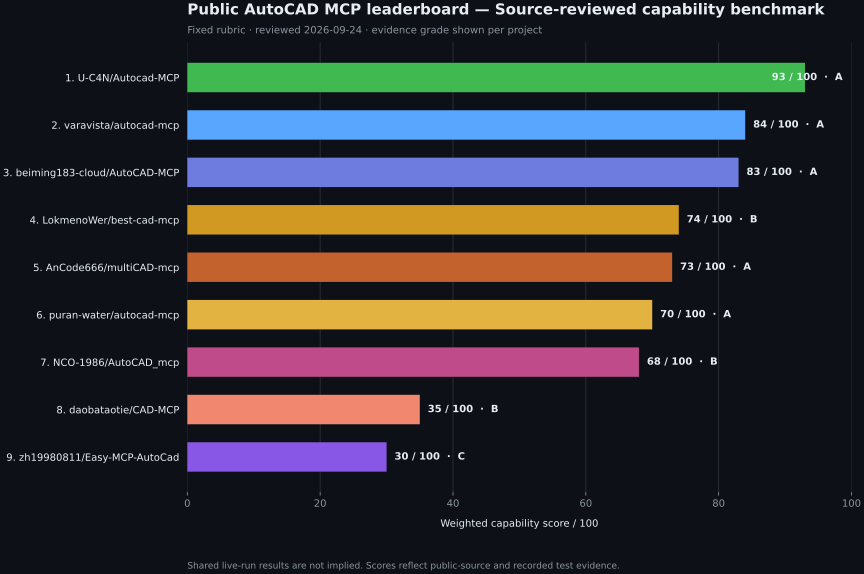

# Benchmarks



## Two evidence layers

This repository publishes two deliberately separate forms of evidence:

1. **Source-reviewed capability benchmark.** Nine named AutoCAD MCP projects are
   scored with a fixed 100-point rubric covering CAD breadth, correctness and
   delivery, backend reach, engineering production, tests, and security. The
   dated data lives in [`source_review.json`](source_review.json), and the README
   graphic is generated—not hand-edited—from that file.
2. **Fixed-task runtime benchmark.** Adapters execute the same task matrix and
   return `pass`, `partial`, `unsupported`, `fail`, `timeout`, `not_run` or
   `environment_blocked`.
   AutoCAD MCP Pro currently has the reference adapter; other projects do not
   receive runtime scores until an adapter actually runs their public interface.

Regenerate the source-review chart:

```bash
pip install -e ".[pdf]"
python -m benchmarks.render_chart
```

The source-review chart is not presented as a shared live AutoCAD run. Review
dates, evidence grades, project URLs, and the boundary are stored with the data.

## Fixed-task runtime runner

The runner separates runtime evidence from the source-review rubric. Every
adapter receives the same tasks and produces the same closed result enum:
`pass`, `partial`, `unsupported`, `fail`, `timeout`, `not_run` or `environment_blocked`. A timeout is
reported per task, and a capability refusal is recorded `unsupported` rather
than `fail` — "cannot reach this" and "got this wrong" are different findings.
Execution is in-process, so adapters that delegate blocking work must provide
cancellation-safe task implementations or be wrapped by an external process
supervisor. Reports include commit SHA, Python/platform details, backend
capability claims, durations, coverage, and hashes for returned artifacts.
Unsupported tasks remain in the fixed-matrix denominator with score zero,
preventing partial implementations from receiving an inflated score. `not_run`
and `environment_blocked` say the task was never attempted and stay out of
every denominator (matrix v8 below).

```bash
python -m benchmarks.run_competitors --list --matrix v8
python -m benchmarks.run_competitors --server autocad-mcp-pro --backend ezdxf --matrix v8 --timeout 180 --json
python -m benchmarks.run_competitors --task table_mleader --task hatch_islands --json
```

The release-machine ezdxf self-check is **31/31 (100.0)** on the v8 matrix
(`--matrix v7` … `--matrix v2` reproduce the earlier sets); the published
report is [`results/published/autocad-mcp-pro.json`](results/published/autocad-mcp-pro.json).
Repository stars and raw tool counts do not contribute to the score. Adapter
registration lives in `competitors.yaml`.

### Matrix v3 (v1.5.0) — five tasks that can fail

v2 scored this server 10/10, and that number carried no information: every task
in it exercised something the server was designed around. `tasks_v3.py` keeps
the v2 ten unchanged — their ids and weights key the published v1.4 reports —
and adds five chosen because they *can* fail. Three of them did, while being
written:

| Task | Category | Verified against |
|---|---|---|
| `tool_discovery` | discovery | six AutoCAD command names, each found in the top 3 of the 154-tool registry the harness ranks — all six came back #1 in the published run |
| `token_budget` | efficiency | 40,305 → 356 tokens advertised, against a 2,000 ceiling fixed in advance |
| `hatch_islands` | hatch | 300 filled with the island, 400 ignoring it |
| `selection_filter` | selection | window 1, crossing 2, bounding box 3, polygon 1 |
| `measure_from_handle` | measurement | 139.2699 against the 100.0 a vertex shoelace gives |

Token counts come from the offline ratio estimator and the report labels them
`ratio/v1 (estimate)`; `token_suite.py --tokenizer anthropic` counts for real.

**Two renames from the release plan, and they are the point.**
`tool_discovery_bilingual` → `tool_discovery`: a Turkish query normalizer was
written and then removed, because this repository is English throughout and the
Turkish was inferred from the author's chat language rather than required by the
product. `measurement_massprops` → `measure_from_handle`: no centroid or
moment-of-inertia tool ships.

**The competitor reports are not re-scored.** Those servers are pinned at v1.4
commits and were run against the v2 matrix; they have never been asked these
five questions. Their scores stand over the ten they ran, and the matrix chart
leaves the five new rows blank (`not run`) instead of scoring them zero — a
zero we invented would be indistinguishable from a zero we measured.

`--matrix v2` stays available so a v1.4 report can be reproduced rather than
only described, and `--publish` writes the artifact-path-free file that
`results/published/` holds.

### Matrix v4 (v1.6) — the P&ID round trip and the page-setup truth

`tasks_v4.py` keeps the v3 fifteen unchanged and adds two tasks that can each
fail on their own:

| Task | Category | Verified against |
|---|---|---|
| `pid_roundtrip` | pid | the example spec drawn through `pid_from_spec`'s code, then read back by the graph builder, which never sees the spec: 5 nodes, 4 edges, 0 dangling ends, `confidence_min` 1.0, zero critique issues, an instrument index of exactly `FIC-101` wired to `FCV-101`, and the two authored line numbers back on the two process lines while the two unnumbered lines carry sequence-built numbers from XDATA |
| `page_setup_truth` | pagesetup | `page_setup_apply("Layout1", ANSI_B landscape 1:1)` then `batch_plot` — the PDF's own `/MediaBox` must parse to 432 × 279 mm (±0.5), a size no fresh document has; then `page_setup_apply("Layout1", ISO_A3 landscape 1:1)` and `batch_plot` again — 420 × 297, the setter's `changed.size_mm` must read `[[432, 279], [420, 297]]`, the page-setup list must say `ISO_A3` / `landscape` / `[420, 297]`, and the ctb must be a known one. A setter that writes nothing fails at the first PDF (`tests/test_benchmark_v4.py` stubs it to prove that) |

The competitor reports carry no result for either, for the same reason they
carry none for the v3 five. `--matrix v3` reproduces the v1.5 set exactly.

### Matrix v5 (v1.6) — the mechanical sheet

`tasks_v5.py` keeps the v4 seventeen unchanged and adds roadmap criterion 3:

| Task | Category | Verified against |
|---|---|---|
| `mech_assembly` | mech | a flange-coupling A3 sheet built through the code the tools call — `apply_titleblock` (ISO 5457 frame with zones and marks, ISO 7200 title block), a hub drawn by `draw_part` with a full section by `add_view` and chain dimensions by `dimension_part`, a flange with its bolt-circle end view, two ISO 4014 M12x60 bolts and two ISO 4032 M12 nuts by `insert_std_part`, the ISO 7573 parts list *read off the drawing* by `extract_records` and drawn by `draw_bom_table`, and one balloon per row linked to that row's inserts by `add_balloon`. The sheet is saved, then gated on two numbers that cannot be negotiated: `run_critique(focus=None)` returns **zero** issues and `combine(validator, critique)` scores at least **90**. The focuses that fired come back in the metrics, and `tests/test_benchmark_v5.py` drops one balloon to prove the gate fails and names `mech_bom_balloon_mismatch` |

Nothing in the task tidies up after the tools: the view engine draws the ISO
128-23 centre lines of every circle it emits, so the sheet is clean because it
was drawn clean. Building it found four defects that every headless test had
missed — the headless diameter text on the wrong side of the chord, the
validator reading a fastener designation (`M12x60`) as a fake dimension, and on
the live seat a missing `MECH` layer and a parts list that could not see a
`BLOCKREFERENCE`; each is fixed with a test. The competitor reports carry no
result for it.

### Matrix v6 (v1.6) — the architectural plan

`tasks_v6.py` keeps the v5 eighteen unchanged and adds track F's evidence:

| Task | Category | Verified against |
|---|---|---|
| `arch_roundtrip` | arch | the plan of `engineering/arch/spec.py::EXAMPLE_SPEC` — a 9 × 6 m brick ring at 250 mm split by a 100 mm AAC wall, an entrance door, an interior door, two windows, a straight stair, two labelled rooms, the exterior chains and the door / window / room schedules — drawn in one transaction by `draw_plan_from_spec`, then read back without the spec: `rooms_detect` on the wall layer must find each labelled room within 0.1 % of the area its label carries **and** of the net floor computed by hand (4825 × 5750 = 27 743 750 and 3825 × 5750 = 21 993 750 mm²), `schedule_rows` must list exactly D1, D2 and W1, W2, and the saved plan is gated like `mech_assembly`: `run_critique(focus=None)` returns **zero** issues and `combine(validator, critique)` scores at least **90**. `tests/test_benchmark_v6.py` removes one room label to prove the gate fails and names `arch_room_unlabelled` |

The competitor reports carry no result for it.

### Matrix v7 (v1.6) — understanding foreign drawings

`tasks_v7.py` keeps the v6 nineteen unchanged and adds track H's evidence, both on the synthetic plant pair of `tests/fixtures/plant_pair.py` (invented names; its truth is computed from the positions it placed, never typed):

| Task | Category | Verified against |
|---|---|---|
| `takeoff_roundtrip` | plant | `scale_check(pid, layout)` must say **schematic** (room 1 is a 1.3× stretch, room 2 is rearranged: 21.8 % of the 55 tag pairs within ±10 % of the median ratio); `pipe_rows(..., length_source="auto")` must report all nine runs with the truth's status, each routable run's layout length equal to the rectilinear MST of its tags to a micron (PR1 5500, PR2 13200, CS1 20700 mm, …), its size and service as drawn — the CIP return drawn on the supply layer included — and both sizes across the reducer; `cable_rows` must give M11 / T102 / M12 / T202 their panels, 6900 / 14100 / 15800 / 8000 mm and 9 / 17 / 19 / 10 m after the 20 % allowance, the heater's power empty. `tests/test_benchmark_v7.py` deletes the wiring callouts and the gate names all four loads |
| `understand_foreign` | understand | `describe(layout)` must infer millimetres and warn about `INSUNITS` (the file says inches), name the stray line's handle in its extents and report two clusters (the plan is drawn twice, 100 m apart); `describe(pid)` must classify `P_product piping`, `P_cipsupplyline`, `P_cipreturnline`, `P_ijswater` and `E_power` as product, CIP supply, CIP return, ice water and electrical. `tests/test_benchmark_v7.py` makes the layout declare millimetres and the units gate fails alone |

The competitor reports carry no result for them.

### Matrix v8 (v1.7.0) — measured acceptance, safe execution, the rivals' ground

`tasks_v8.py` keeps the v7 twenty-one unchanged and adds ten. Each runs once in `tests/test_benchmark_v8.py` and once on a broken input, where its gate must fail and say what failed:

| Task | Category | Verified against | Broken input that must fail it |
|---|---|---|---|
| `requirements_roundtrip` | verify | a 120 × 80 plate drawn from its part model in mm: four requirements bound by feature tag (Ø20 bore, 90 pitch, bore 51.478 = √(45² + 25²) from c1, exactly four Ø8) pass on the document; the saved file's bore is moved 3 mm inside the outline (counts and extents unchanged — what 1.6's parity compared) and **exactly R3** fails (54.120 = √(48² + 25²)), re-bound from the document and opened alone by a fresh engine | `verify_artifact` replaced by a read of the in-memory document |
| `cancel_safety` | reliability | a call cancelled while its worker holds the drawing; the next call runs after the worker (trace A, then B) | an `_async` that releases the drawing on cancel |
| `qa_large_drawing` | reliability | 10,000 lines with CONSTRUCTION lines at position 5,001, after 10,000 and on Layout1, and a duplicate pair drawn backwards: all found by handle, no `scan_incomplete`, no `check_failed` | `MAX_QA_ENTITIES = 5000` |
| `export_safety` | reliability | a P&ID whose authored line number is `=1+1` (read back off the drawing) and block attributes / an ACADMCP_MECH payload carrying `@SUM(A1:A9)`, `+cmd\|…`, `-2+3`: no CSV cell a spreadsheet would evaluate, only string cells in XLSX, the `-12.5` mass numeric | a `csv_text` without the `'` |
| `stale_preview` | preview | a `cad_batch` dry run, the line recoloured directly in the document, the apply refused `stale_revision` naming that handle, the line unmoved; a fresh preview applies | a fingerprint that cannot see the edit |
| `revision_guarded_edit` | preview | beiming183's ground: two guarded edits move the revision forward; a third on the first revision is refused with expected / actual revisions and changes nothing | a revision that never moves |
| `pid_file_roundtrip` | pid | puran-water's ground: `EXAMPLE_SPEC` drawn, saved, reopened by a fresh engine: same tags, edges, line numbers, instrument index, equipment list, nothing dangling | a save that drops a process line |
| `foreign_edit_verified` | verify | a raw-ezdxf plate (no record of ours) measured by geometric selectors: only H3 (drawn Ø9) fails; repaired by a `cad_batch` under its fingerprint precondition; the saved file passes all six and a diff shows one changed entity | an `entity_edit_geometry` that does nothing |
| `damaged_dxf_refusal` | reliability | a truncated DXF and a non-DXF refused with the fault named, the open document kept (same id, revision, entities). 1.7.0 refuses; `recover` is B09, 1.7.1 | an open that silently returns an empty drawing |
| `dimension_binding` | verify | best-cad's claim: four DIMENSIONs bound to the features at their defpoints; rows measured on geometry (42, 40, 21, Ø40 all pass), the "42" override over 40 and the DIMLFAC 2 over 21 are `dimension_mismatch` findings that block acceptance | a displayed value that believes the geometry |

The v8 tasks stage their inputs inside the headless engine; on the live engine they report `not_run` (the live evidence is the COM harness, `scripts/live`).

**No zero for a task nobody asked.** A rival lane reports a task it has no playbook for as `not_run` (a v2 task keeps the v1.4 verdict, `unsupported`), and a lane whose environment is absent — no cached checkout or venv at the pinned commit with `--no-fetch`, a clone or install that cannot run — as `environment_blocked`. Neither enters the score: `summary.score` is over attempted tasks and is `null` when nothing was attempted. `competitors.yaml` lists best-cad-mcp with `"adapter": null` (COM-only), so its lane is `not_run`. The v8 rival records live in [`results/published/lanes-v8/`](results/published/lanes-v8/); the v1.4 rival reports are not touched.

**Run manifest.** Every report carries `manifest`: the server's commit and whether tracked files were modified (`dirty`), the sha256 of the files that generate the fixtures (`FIXTURE_SOURCES`), `EVALUATOR_VERSION` and the installed versions of ezdxf, fastmcp, mcp, numpy, openpyxl, matplotlib and pywin32.

### Matrix v9 (v1.8.0) — call economy, dimension truth, security, durability, the named promises

`tasks_v9.py` keeps the v8 thirty-one unchanged and appends the 1.8.0 tasks per
plan item, into the same `MATRICES` registry `run_competitors` imports
(`--matrix v9`). `DEFAULT_MATRIX` stays `v8` until the release item 1.8-25 moves
it. v9 holds 44 tasks, v8's 31 plus these 13:

| Task | Category | Verified against |
|---|---|---|
| `dimension_lie_detect` | qa | `tests/fixtures/lying_dims.py`: seven dimensions that each lie one way give exactly one `dimension_truth` finding each; DIMDEC 0 over 19.6 shows "20"; a redraw left stale by `rerender=False` is named and `drawing_refine` clears it |
| `policy_read_only` | security | under `READ_ONLY`, a batch with one create step is refused before step 1 with the revision unchanged, and the same write sent through the search proxy's `call_tool` is `policy_refused` |
| `lisp_read_tier` | security | three AutoLISP reads (`vla-get-Area`, `getvar`, a `mapcar` over a `lambda`) answer on the first try and `(command "_ERASE" ...)` is refused with its symbol, line and typed alternatives; live engine only (headless: `environment_blocked`) |
| `layer_cleanup_budget` | ergonomics | six misnamed layers and 300 overridden entities reach ISO names, ByLayer and no empty layer in at most 3 calls, with the `iso128` / `layer_color` / `property_override` critique empty; a stale `expect_count` is refused `stale_revision` with nothing changed |
| `call_count_dimension_part` | ergonomics | a plate (outline, six holes, two arcs) dimensioned in at most 2 calls, every dimension bound with no `dimension_mismatch` and no duplicate, a second run drawing nothing; an ELLIPSE and a SPLINE in the selection are `omitted` with their reasons |
| `undo_across_restart` | durability | draw, save, move, save, kill the server; a new process opens the file and one `drawing_undo` puts the line back before the move. Unsaved twin: the file is untouched and `lost_since_save.count` is 1 |
| `atomic_batch_default` | durability | a line moved and a handle that does not exist deleted in one batch with no `on_error`: refused `unknown_handle`, nothing executed, the line unchanged. Run-time twin: the default rolls the move back, verified |
| `history_value_lookup` | durability | three rounds of a plate (hole 10, 12 labelled `round 2`, 16), saved, the server killed; a new process finds the round-2 diameter 12 in at most two calls (`drawing_open` + `drawing_history`). Twins: a label nobody gave is refused by name; an unlabelled round is read from the checkpoint diff |
| `parametric_revise_keeps_handles` | parametric | a dimensioned three-view flange revised in one `mech_part_revise` (bore 20 → 24, length 60 → 70, + chamfer, - radius): in-place handles kept, signatures equal to a fresh draw, the dimensions read 24 and 70, the bore requirement passes. Twin `revise_hand_edit_refused`: a hand-moved tagged line is refused `hand_edited_tagged_entity` with the fingerprints unchanged |
| `pid_routing_obstacles` | pid | a sheet whose `auto` lines cross two vessels, routed with `sheet.routing: "avoid"`: zero `pid_line_through_symbol`, zero dangling ends, crossings within the dry run's; a walled-in pump refused `no_route` naming the four vessels' tags |
| `pid_project_offpage` | pid | three P&ID sheet files checked by `pid_project`: one orphan link, one direction mismatch, one cross-sheet duplicate tag and one line-number mismatch, each once with sheet and handle; a missing sheet file and 51 sheets refused by name |
| `std_tables_b40` | standards | one size from every filled DIN 471/472, DIN 509, DIN 332-1 and ISO 3601-2 table drawn with the double entry's own dimensions, a size between two rows refused by name with nothing drawn. With no table filled - the 1.8.0 state, every table deferred to 1.8.1 - it is `not_run` naming the deferred tables, never a pass |
| `dwg_headless_roundtrip` | reliability | a DWG opened on the headless engine through a converter (ODA, then `accoreconsole`) and saved as DXF with the layers, blocks and entity counts of its DXF twin; with no converter on the machine the open is refused `dwg_read` and the task is `environment_blocked` |

`dimension_lie_detect`, `layer_cleanup_budget`, `call_count_dimension_part`,
`undo_across_restart`, `atomic_batch_default`, `history_value_lookup`,
`parametric_revise_keeps_handles`, `pid_routing_obstacles`,
`pid_project_offpage` and `dwg_headless_roundtrip` stage their inputs in the
headless engine and are `not_run` on the live lane (`HEADLESS_ONLY_V9`).
`pid_roundtrip` (v4) is pinned to `sheet.routing: "auto"`, so v9 does not
change what v4 measured.

**Search mode is not vacuous.** Under the 1.8.0 default (`DISCOVERY_MODE=search`)
the reference adapter's in-process MCP-client tasks reach every non-synthetic
tool through `call_tool`, and the adapter reports `discovery_mode` and
`proxied_calls` in its metadata. On the 1.8-11 branch, v8 passed 31 / 31
(`proxied_calls` 9) and v9 33 / 33 (`proxied_calls` 41) under the new default.

## Live competitor lane (v1.4)

Two competitor adapters now execute the exact same task matrix, black-box over
MCP stdio, against commits pinned in `competitors.yaml`:

| Server | Matrix | Pinned | Score | Pass | Coverage |
|---|---|---|---:|---:|---:|
| autocad-mcp-pro (reference) | v8 (31) | 1.7.0 tree | 100.0 | 31/31 | 100% |
| beiming183-cloud/AutoCAD-MCP | v2 (10) | `11f7c47e` | 50.0 | 5/10 | 50% |
| puran-water/autocad-mcp | v2 (10) | `95476a33` | 45.0 | 4/10 | 50% |

The competitor rows are the v1.4 runs, unchanged. Read the matrix column
before the score column: the denominators differ because the twenty-one tasks
added since v2 came after those runs and have not been put to them.

Method and boundaries:

- `benchmarks/competitors_env.py` clones the pinned SHA into
  `benchmarks/.competitors/<id>/` (gitignored), builds an isolated venv, and
  installs the competitor from its own `pyproject.toml`.
- `benchmarks/adapters/mcp_stdio.py` drives the competitor exactly like an MCP
  host (fastmcp `Client` over stdio). No competitor code is imported.
- Task playbooks call each server's **own documented tool contract**, read from
  the pinned source (consolidated `operation` + payload tools; beiming's
  `doc_id`/`expected_revision` discipline is honored via
  `transaction(operation="context")`).
- **Verification never trusts the competitor's response**: every geometry claim
  must survive `save`/`save_as_dxf` and re-opening the DXF with ezdxf inside
  the harness.
- Tasks with no documented equivalent are reported `unsupported` with the
  reason string; they stay in the fixed-matrix denominator at score zero.
- This lane is headless (ezdxf backends only). File-IPC / live-AutoCAD lanes
  (including COM-only servers such as best-cad-mcp or daobataotie/CAD-MCP)
  require a local AutoCAD session and are out of CI scope by design.

Published machine-readable reports (artifact paths sanitized to filenames)
live under [`results/published/`](results/published/); the README charts are
regenerated from them:

```bash
python -m benchmarks.run_competitors --server puran-water-autocad-mcp --backend ezdxf --matrix v2
python -m benchmarks.run_competitors --server beiming183-autocad-mcp --backend ezdxf --matrix v2
python -m benchmarks.render_live_chart     # score bars
python -m benchmarks.render_matrix_chart   # tasks x servers status heatmap
```

`--publish <path>` writes the same report with artifact paths reduced to
filenames, which is how `results/published/` is produced; the sha256 stays,
because that is what makes an artifact checkable.

## Headless performance lane

`perf_suite.py` measures wall time on fixed workloads through the same backend
methods the MCP tools call (server-side overhead included): 2,000 individual
line creates, a 10,000-entity build → DXF export → reopen roundtrip, a region
query over 10,000 entities, and a full premium quality pass (ISO layers,
geometry, dimensions, complete critique). The report records the machine
fingerprint; numbers move with hardware, workload definitions do not.
**Self-measurement only** — competitor servers would pay an extra stdio
serialization cost that in-process runs do not, so no cross-server timing
claims are made.

```bash
python -m benchmarks.perf_suite --out benchmarks/results/published/perf-ezdxf.json
python -m benchmarks.render_perf_chart
```

### v1.6.0 against v1.7.0 (the spec §8.3 gate)

1.7.0 must not be slower than 1.6.0. `perf_compare.py` builds a v1.6.0 worktree
and measures both trees in alternating rounds (base, head, head, base, ...)
with one interpreter, each tree importing its own packages and running this
checkout's workloads: `perf_suite`'s four plus `server_create_lines_2k`, 2,000
`entity_create_line` calls through an in-memory FastMCP client, so the
middleware is measured too. `--aa` measures the base a second time in every
round; the spread of those base / base ratios is the noise floor, and the
bound is `1 + max(0.05, 2 × spread)`. Medians of 20 rounds after 5 warm-ups,
from [`results/published/perf-v1.6.0-vs-v1.7.0.json`](results/published/perf-v1.6.0-vs-v1.7.0.json):

| Workload | v1.6.0 | v1.7.0 | ratio |
|---|---:|---:|---:|
| 2,000 lines, one call each | 492.1 ms | 454.9 ms | 0.95 |
| 10,000 lines: build, DXF export, reopen | 5,139.3 ms | 4,986.8 ms | 0.91 |
| Region query over 10,000 entities | 1,377.6 ms | 1,012.8 ms | 1.02 |
| Premium quality pass | 182.7 ms | 108.0 ms | 0.62 |
| 2,000 `entity_create_line` calls through the MCP server | 14,414.4 ms | 13,412.6 ms | 0.96 |

Measured on an idle machine: the A/A spread was 5.5 %, so the bound was
1.11, and the region query's 1.02 is inside that noise. The ratio is the
median of each round's paired head / base ratio, not the ratio of the two
medians, which is why that row's medians point the other way. 1.7.0 does not win back
v1.4.0's creation throughput; that is B10, 1.7.1.

```bash
python -m benchmarks.perf_compare --base v1.6.0 --aa --out out/perf/compare.json
python -m benchmarks.perf_compare --aa --out out/perf/compare.json   # --base auto (default since 1.8.0)
```

Since 1.8.0 `--base` defaults to `auto`: the previous release tag, found with
`git describe --tags --abbrev=0` from HEAD (from `HEAD^` when a tag points at
HEAD itself). With no reachable tag it refuses by name - fetch the tags or pass
`--base <tag>`. It is not yet wired into a nightly or release workflow.

### v1.4.0 against v1.6.0, and what the call-timeout guard costs

The published v1.4 report was recorded on CPython 3.14 and the later ones on
3.11.15, so comparing those files directly shows an apparent speedup that is
almost entirely the interpreter. The comparison that means something runs one
interpreter and one ezdxf over each tree's own code: 1.6.0's `perf_suite.py`
(v1.4.0 had none) against a v1.4.0 worktree, against 1.6.0, and against 1.6.0
with the guard off — five rounds, the three configurations alternating within
a round. Medians, from
[`results/published/perf-v1.4.0-vs-v1.6.0.json`](results/published/perf-v1.4.0-vs-v1.6.0.json),
which keeps every run:

| Workload | v1.4.0 | v1.6.0 | v1.6.0, `EZDXF_CALL_TIMEOUT=0` |
|---|---:|---:|---:|
| `create_lines_2k` | 244.5 ms | 306.1 ms (1.25×) | 284.9 ms (1.17×) |
| `roundtrip_10k` | 1,847.9 ms | 2,553.5 ms (1.38×) | 2,216.4 ms (1.20×) |
| `region_query_10k` | 665.2 ms | 712.2 ms (1.07×) | 783.9 ms (1.18×) |
| `premium_pass` | 150.6 ms | 65.3 ms (0.43×) | 69.9 ms (0.46×) |

The guard explains part of the creation cost, not all of it. v1.5.1 rebuilt
the wrapper around one `asyncio.timeout_at` instead of two `asyncio.wait_for`s
(`wait_for` wraps its awaitable in a Task, so the old shape created two extra
Tasks and two timer handles per call), which recovered about a third of its
overhead; the rest is the Task the abandon-on-timeout design needs. With the
guard off, creation is still 1.17× and 1.20× v1.4.0's time. A cProfile of the
event-loop thread over the 2,000 creates counts **491,071** function calls on
1.6.0 against **319,038** on v1.4.0: per-call work added since 1.4 that 1.6
has not removed. The region-query row, whose guard-off median is the slower
one, is this machine's noise floor (about ±10 %).

Roadmap criterion 7 — headless creation throughput back to v1.4.0's numbers —
is therefore **not met** and moves to 1.7. Earlier versions of this page said
that `EZDXF_CALL_TIMEOUT=0` returned creation to v1.4.0's numbers; measured
this way, it does not. The guard stays: it is what stops one hung ezdxf call
wedging a server whose document lock is a single `asyncio.Lock`.

`perf-ezdxf.json`, the chart's input, is the median of the five
default-configuration runs, with every run kept in `runs_ms`.

Reproduce (the v1.4.0 tree needs 1.6.0's `benchmarks/perf_suite.py` copied in):

```bash
git worktree add ../v140 v1.4.0 && cp benchmarks/perf_suite.py ../v140/benchmarks/
for i in 1 2 3 4 5; do
  python -m benchmarks.perf_suite --json > main-$i.json
  EZDXF_CALL_TIMEOUT=0 python -m benchmarks.perf_suite --json > off-$i.json
  (cd ../v140 && python -m benchmarks.perf_suite --json) > v140-$i.json
done
```

The profile, run from each tree's root:

```python
import asyncio, cProfile, pstats
from backends.ezdxf_backend import EzdxfBackend


async def work():
    b = EzdxfBackend()
    await b.connect()
    await b.drawing_new()
    for i in range(2000):
        await b.entity_create_line(0, i, 100, i)
    await b.disconnect()


pr = cProfile.Profile()
pr.enable()
asyncio.run(work())
pr.disable()
print(pstats.Stats(pr).total_calls)
```

## Live COM performance lane (1.8-23) - written, not yet run

`perf_com.py` measures the live engine against a v1.7.0 checkout on a running
AutoCAD, never in CI. Each side runs in its own child process with its own
backends and server first on `sys.path`, through an in-process fastmcp client,
on a document seeded with 5,000 lines; every repeated workload gets one untimed
warm-up, and what a workload created is removed untimed so each runs at about
5,000 entities. The workloads: `create_circle_singles`, `batch_create_200`,
`delete_singles_200`, `delete_many_200`, `cad_batch_50`, `fillet_50_n5000` and
`fillet_50_n10000`. Its targets were fixed before any run: the bulk tools at
least 5× faster than v1.7.0's 200 single calls, the single
`entity_create_circle` median at least 30 % lower, and `entity_fillet` at
10,000 lines at most 1.2× its time at 5,000. The bulk-delete target is measured
on the tool as 1.8.0 ships it, pre-check and transaction included.

```bash
python -m benchmarks.perf_com --base <a v1.7.0 checkout>   # writes results/live/perf_com.json
python -m benchmarks.perf_com --pending   # the skeleton; no AutoCAD
```

AutoCAD was not open when 1.8-23 was written, so
[`results/live/perf_com.json`](results/live/perf_com.json) is the `--pending`
skeleton: `status: "pending"`, the targets, every verdict `pass: null`. No live
number is claimed. ADR 0001 (`docs/adr/0001-native-worker.md`) names a recorded
live `perf_com.json` as what would trigger its one-day worker spike.

## Token and call budgets (1.8.0)

`token_suite.py` measures what the server costs a model in tokens, offline (a
characters-per-token ratio, labelled `ratio/v1`; `--tokenizer anthropic` counts
for real). Four lanes: `idle` (the advertised catalog and the server
instructions, per profile and pack set; the headline is the **prompt payload**
a client forwards to the model, the tools/list wire payload is the `wire`
column; report schema `token/2.0`), `discovery`, `result`, and since 1.8.0
`task`. The task lane runs five scripted jobs - `sketch_20_entities`,
`layer_cleanup_300`, `dimension_plate`, `inspect_foreign`,
`history_value_lookup` - each two ways: **naive**, one tool per entity, labelled
as the shape a rival was observed using and not as the least this server needs,
and **batched**, the least-call oracle of `call_budget.py`. Each arm reports its
calls, request and result characters, and a modelled 30-turn session input
cached and uncached (turn *k* re-sends the prefix and every earlier request and
result). An arm that does not finish its job fails; an oracle whose tool is not
on the tree yet reports `pending_tool`, never a pass.

`call_budget.py` owns the fixtures (plain ezdxf files), the scenarios and their
verifiers; setup and verification calls are not counted. The plan's ceilings
live in `token_budget.json`, written at the start of W2 before any token work,
each cell with a gate and an owner: `ci` cells fail every PR, `release` cells
(over their ceiling on the tree, or owned by a later item) are reported under
`over_ceiling` / `pending` and fail only `--release`. Every idle row, and the
instructions row, also fails when it grows more than 5 % over the published
`results/published/token-cost.json`.

```bash
python -m benchmarks.token_suite --lanes idle,task --budget benchmarks/token_budget.json --out out/token-budget.json
python -m benchmarks.token_suite --budget benchmarks/token_budget.json --release   # the release gate
python -m benchmarks.call_budget --out out/call-budget.json
```

The CI job `token-budget` runs the first and the third on every PR. The call
oracles measured so far: `sketch_20_entities` 1 call (naive 20),
`layer_cleanup_300` 2 (one `cad_batch` of `layer_merge` + `entity_modify_where`,
then `drawing_critique`; naive 311; 1.7.0 took 124, the rival 11),
`dimension_plate` 2 (`dimension_auto(selector=...)` + `drawing_critique`; naive
23; 1.7.0 89, the rival 10), `inspect_foreign` 1 (`drawing_understand`; naive
5), and since 1.8-10 `history_value_lookup` 2 (`drawing_open` +
`drawing_history(handle=..., detail="args")`; 1.7.0 could not answer it). The
history oracle counts its two calls in one in-process client; the restart half
is proven by the v9 task and the `history_round2_value` check, which kill real
server processes.

The cells' gates as `token_budget.json` holds them now:

| Lane | Cell | Ceiling | Gate | State |
|---|---|---:|---|---|
| idle | `default` | 65,594 tokens | `ci` | owner 1.8-14 |
| idle | `lean` | 18,842 | `release` | over its ceiling at W2 start (18,961); owner W3, the `Details:` split, which is 1.8.1 |
| idle | `packs_core` | 43,997 | `release` | over its ceiling at W2 start (44,235); same owner |
| idle | `search` | 250 | `ci` | measured by 1.8-11: 220 prompt / 230 wire |
| idle | `search_pinned` | 1,500 | `ci` | measured by 1.8-11: 1,003 prompt / 1,277 wire, six tools |
| idle | `instructions` | 250 | `ci` | measured by 1.8-11: 199 tokens |
| result | `system_status_1000_rows`, `critique_500_summary`, `finalize_qa_coverage`, `error_envelope`, `history_row` | see the file | `release` | the result-lane rows are not yet measured by `token_suite`; tests hold `system_status` (+300 bytes at 1,000 rows), the 500-issue summary, finalize's `qa_coverage` and `drawing_history(limit=10)` (under 400 tokens) |
| task | `sketch_20_entities`, `inspect_foreign`, `layer_cleanup_300`, `dimension_plate`, `history_value_lookup` | 1, 1, 3, 2, 2 calls | `ci` | measured |
| real model | `plugin_eval` | 6 calls per case | `release` | 1.8-11's runs: `layer-cleanup-budget` 3 and 6 (pass), `dimension-budget` 9 and 12 (over); `history-round2` written, not yet run |

The measured token values above are the items' own; the numbers pass retakes
every cell on the release tree.

## Correctness A/B suite

`correctness_suite.py` is a set of deterministic, headless (ezdxf-backend) checks
that exercise real drawing operations. `compare_versions.py` runs the **same**
suite against an older git ref and the current checkout, each check in its own
subprocess so a hard crash (e.g. a matplotlib-in-thread `SIGSEGV`) is recorded as
a miss rather than taking down the run.

Reproduce:

```bash
python benchmarks/compare_versions.py            # current tree vs origin/main
python benchmarks/compare_versions.py v1.0.0     # vs a tag/ref
python benchmarks/compare_versions.py --json results.json
python benchmarks/compare_versions.py v1.6.0 --fail-on-regression   # exit 1 on any regression
```

The suite file under test is always the current one: the old tree runs it with
its own code on `PYTHONPATH`, so a check imports anything newer than the
baseline inside its function, and a check the baseline cannot pass records
`fail` or `miss` there - an improvement, never a regression. A check is a
function placed just before `CHECKS` (the file ends in `main()`) and an entry at
the end of `CHECKS`.

**On the 1.8.0 branch, with W2 and W3 merged,** the suite holds 83 checks: the
67 below plus twelve W2 and four W3 checks, each passing on the branch. The
published report is still the W1 run over 67 and is regenerated over all 83
by the numbers pass (`benchmarks/results/published/ab-v1.7.0-vs-v1.8.0.json`).

| Check | Category | Item | Verified against |
|---|---|---|---|
| `qa_coverage_not_checked` | Quality gate | 1.8-16 | a paper layout with content and no model viewport is named `not_checked` (`no_viewport_scale`) by the critique report and by finalize's `qa_coverage`, and `strict_critique=True` fails on it |
| `dimension_display_truth` | Dimensions | 1.8-15 | 19.6 mm after DIMDEC 2 → 0 shows "20" in the `*D` block and in `bind_dimension`, `display_rounding` 0.4, no mismatch |
| `dimension_truth_focus` | Quality gate | 1.8-15 | an override lie, a doubled Ø and a stale render are exactly their three codes; `drawing_refine` redraws only the stale one |
| `policy_read_only_batch` | Security | 1.8-17 | `READ_ONLY` refuses a one-create-step `cad_batch` (`policy_refused`, `read_only`) with the revision and the entity count unchanged |
| `write_path_autoload_refused` | Security | 1.8-17 | `data_extract` → `acaddoc.lsp` and `drawing_save_as` → `acad.lsp` are `path_refused`, nothing written |
| `dimension_auto_one_call_part` | Dimensions | 1.8-13 | one `dimension_auto(selector=...)` dimensions a plate (4 edges, six Ø11, two R8, sizes read off the DIMENSIONs), omits the ellipse, and a rerun draws nothing |
| `property_override_focus` | Quality gate | 1.8-01 (the plan's section-8 check W1 did not add) | through the server: a clean GEOMETRY line yields nothing; one given colour 1 and lineweight 30 is named by exactly `lineweight_not_bylayer` (error) and `color_not_bylayer` (warning) with only its handle; `drawing_refine` applies both repairs and leaves it at colour 256 and ByLayer |
| `search_default_lists_pins_and_batch_first` | Discovery | 1.8-11 | with nothing set, a client lists exactly `search_tools`, `call_tool`, `describe_tool`, `cad_batch`, `drawing_info` and `entity_list`; an unlisted `entity_create_line` still runs on a direct call; `describe_tool(names=[...])` answers two cards in one call; the instructions name `cad_batch`, nothing unlisted and no `titleblock_apply_iso_a3` |
| `undo_after_restart` | Durability | 1.8-08 | a real `python server.py` draws, saves, moves, saves and is killed; a new process opens the file and one `drawing_undo` puts the line back with `granularity: "save"`; a killed unsaved session leaves the file as saved and the next open reports `lost_since_save.count == 1` |
| `atomic_batch_default` | Durability | 1.8-09 | `[entity_move(L), entity_delete("DEAD")]` with no `on_error` is refused `unknown_handle` with L unchanged; the run-time twin is rolled back by the default with `atomicity.verified` true |
| `delete_many_all_or_nothing` | Durability | 1.8-09 | `entity_delete_many([A, "DEAD"])` keeps A and does not answer `ok: true`; a delete made to fail mid-call answers `ok: false` with A, B and C all still in the drawing |
| `history_round2_value` | Durability | 1.8-10 | the round-2 hole diameter (12) of a three-round plate is read back after a killed server in two calls (`drawing_open` + `drawing_history(label="round 2", detail="args")`); an unknown label is refused `invalid_args` naming the labels; an unlabelled round is read from the checkpoint diff |
| `pid_project_links` | P&ID | 1.8-21 | two sheet files: a matched link whose line numbers disagree, an orphan, a direction mismatch and a pump on both sheets, each reported once with sheet and handle; 51 sheets refused by name |
| `pid_avoid_no_symbol_crossing` | P&ID | 1.8-20 | a pump discharging into a far vessel with another between them: with `sheet.routing: "avoid"` the polyline enters no symbol's box but its two ends (each INSERT's own ezdxf bounding box, not the server's focus) and the graph read back holds no dangling end |
| `b40_between_rows_refused` | Mechanical | 1.8-22 | every empty B40 table refuses a lookup naming itself; on a synthetic double entry (round numbers, not DIN values) a listed size draws its row, a size between two rows is refused with both neighbours named and nothing drawn, and an entry B one value off entry A is refused by path |
| `mech_revise_keeps_handles` | Mechanical | 1.8-19 | a Ø60 × 30 bushing revised to a Ø24 bore and length 40: every LINE / CIRCLE / ARC edited in place keeps its handle, the end view's bore circle is r = 12, the signatures equal a fresh draw of the revised part; a tagged line moved 1 mm by hand refuses the revision `hand_edited_tagged_entity` with nothing changed |

### Result — v1.8.0 vs v1.7.0 (release gate, W1 state)

67 checks, ezdxf backend, one subprocess per check. Machine-readable report:
[`results/published/ab-v1.7.0-vs-v1.8.0.json`](results/published/ab-v1.7.0-vs-v1.8.0.json).

| Version | Checks passing | Pass rate | Fixed | Regressed |
|---------|----------------|-----------|-------|-----------|
| **v1.7.0** (baseline)     | 61 / 67 | 91.0 % | — | — |
| **v1.8.0** (this release) | 67 / 67 | 100 % | 6 | **0** |

Six are fixed, one per W1 item of 1.8.0. Four are `fail → pass`: v1.7.0 has every
method they call and gets the answer wrong. `journal_replay_after_kill` kills a
server after a `cad_batch(operation_id=…)` and sends the same id to a fresh
process: 1.7.0's in-memory journal had forgotten it and drew the batch again;
now it answers `replayed: true` (B13, 1.8-03). `atomic_save_untouched_on_failure`
holds the target open while a save runs: 1.7.0 wrote straight into it; now the
save is refused `save_locked` with the target's bytes untouched and no `.tmp`
left (1.8-04). `lineage_revision_continues` reopens an unchanged file in a fresh
backend: 1.7.0 started a new document at revision 0; now the same `document_id`
and revision continue (1.8-04). `region_render_applied` asks for a window:
1.7.0 answered `applied: false` and rendered the extents; now the region is
drawn at the requested pixel size with one `px_per_unit` (1.8-07). The other two
are `miss → pass`: `lineweight_truth` reads `lineweight_name` and the named
`"ByLayer"` parser, and `error_envelope_routes_agree` compares the typed
envelope on the direct and the `cad_batch` route - neither exists on 1.7.0
(1.8-01, 1.8-02). The 61 checks v1.7.0 was released on all still pass.

### Result — v1.7.0 vs v1.6.0

61 checks at the time, ezdxf backend, one subprocess per check. Machine-readable report:
[`results/published/ab-v1.6.0-vs-v1.7.0.json`](results/published/ab-v1.6.0-vs-v1.7.0.json).

| Version | Checks passing | Pass rate | Fixed | Regressed |
|---------|----------------|-----------|-------|-----------|
| **v1.6.0** (baseline)     | 48 / 61 | 78.7 % | — | — |
| **v1.7.0** (that release) | 61 / 61 | 100 % | 13 | **0** |

Thirteen are fixed. Four are `fail → pass`: v1.6.0 has every method they call and gets the
answer wrong. They are the three reproducers of the 1.7.0 W1 review focus and
the shared spec validation. `cancel_never_overlaps` cancels a call whose worker
is blocked and starts a second one: on v1.6.0 the second ran while the first
worker was still inside the drawing; now it waits for that worker (B01).
`qa_scan_finds_entity_5001` puts a construction line at position 5,001: the
1.6.0 critique read the first 5,000 entities and reported nothing (B02).
`export_text_never_formula` writes a parts list whose designations are `=1+1`,
`@x` and a tab-led text beside a `-12.5` mass: 1.6.0 wrote the text verbatim
to CSV and as formula cells to XLSX; now CSV carries a leading `'` on text
only and XLSX holds string cells and a numeric mass (B03).
`spec_refuses_non_finite` hands a vessel a NaN width and an infinite height
and `pid_from_spec`'s dry run a NaN scale: 1.6.0 accepted the first, died in
a `RuntimeError` on the second and approved the third; each is now refused by
its path (B07). The other nine are `miss → pass`: the roadmap's acceptance
scenarios T05, T09-T13, T18, T25 and T36 (`verify_t*`), which call the
verification engine 1.7.0 added - a stale preview refused with nothing moved,
a Ø39.8 bore failing under its "Ø40" label, a moved hole failing against the
model that still says it did not move, an inner hole moved inside a saved
file, two equal holes left ambiguous, five and seven holes failing "exactly
six", an override and a DIMLFAC made blocking findings, a renumbering save
re-bound by geometry, and a delivery made stale by an edit after it. The 48
checks v1.6.0 was released on all still pass.

### Result — v1.6.0 vs v1.5.1

48 checks at the time, ezdxf backend, one subprocess per check. Machine-readable report:
[`results/published/ab-v1.5.1-vs-v1.6.0.json`](results/published/ab-v1.5.1-vs-v1.6.0.json).

| Version | Checks passing | Pass rate | Fixed | Regressed |
|---------|----------------|-----------|-------|-----------|
| **v1.5.1** (baseline)     | 26 / 48 | 54.2 % | — | — |
| **v1.6.0** (that release) | 48 / 48 | 100 % | 22 | **0** |

The twenty-two are all `miss → pass` — v1.5.1 has none of the methods. Five are track H: `scale_check_detects_schematic` (the synthetic P&ID is schematic against its layout; a uniform 2× copy is to scale with factor 2), `pipe_takeoff_rmst_exact` (eight routable runs, each exactly the rectilinear MST of its tags), `cable_takeoff_roundup` (9 / 17 / 19 / 10 m, the unstated power left empty), `diff_detects_known_edits` (five known edits and nothing else) and `topology_known_defects` (one near miss, one crossing, a clean T). Four are track F: `arch_junction_l_t_x` (L, T and X junction outlines against hand-computed corners and wall areas), `arch_room_area_net` (a 4 × 5 m room between 200 mm walls is labelled 20.00 m², not its 21.84 m² axis area), `arch_opening_cuts_wall` (both faces interrupted across a door, two jambs) and `arch_rooms_detect_foreign` (plain lines on a WALLS layer read as 20 and 15 m² at confidence 0.6, nothing written). Seven
are tracks B and G: `mech_part_roundtrip` (a part read back from its own
`ACADMCP_MECH` XDATA equals the part drawn), `mech_section_hatch_area` (a
sleeve 60 long, ⌀40 outside, ⌀20 bore: a full section cuts two 60 × 10 faces,
1200 mm² exactly, measured out of the drawing by `entity_measure` — never from
the code that drew it), `mech_iso286_on_dimension` (ISO 286-1: 40 H7 is
+0.025 / 0, and the fit survives `layout_dimensions`),
`mech_thread_unrepresented_is_caught` (the ISO 6410 focus fires on a thread
drawn as a plain circle and stops firing once the thin ¾ arc is there — the
mechanical twin of `dim_overlap_critique_fires`), `std_part_iso4014_m12` (ISO
4014:2011 table 1, M12: s = 18, k = 7.5, matched by value; the inserted block
carries its designation back), `sheet_frame_iso5457_a3` (the frame runs 20,10
to 410,287 inside the 420 × 297 trimmed sheet) and `bom_balloon_link` (two
identical bolts collapse into one row of quantity 2 with a stable item number,
and that row's balloon carries it). The other six are the three
P&ID checks track A added (`pid_block_define_attdef_roundtrip`,
`pid_tag_parse_fic`, `pid_graph_edge_count`) and the three settings checks of
track E (`settings_dimstyle_iso25_values`: the ISO-25 preset reaches the
DIMSTYLE table with ISO 129-1's numbers, read back through ezdxf and not
through the lister; `settings_layer_state_roundtrip`: save → change → restore
puts the layer table back and the state survives save/reopen as an XRECORD in
the file; `settings_pdf_mediabox_a3`: the plotted PDF's own `/MediaBox` reads
420 × 297 mm). Every one of the 26 checks it was released on still passes, so
the five tracks added capability without moving a number it had already earned.

### Result — v1.5.1 vs v1.5.0

26 checks at the time, ezdxf backend, one subprocess per check. Machine-readable report:
[`results/published/ab-v1.5.0-vs-v1.5.1.json`](results/published/ab-v1.5.0-vs-v1.5.1.json).

| Version | Checks passing | Pass rate | Fixed | Regressed |
|---------|----------------|-----------|-------|-----------|
| v1.5.0 (baseline)     | 24 / 26 | 92.3 % | — | — |
| v1.5.1 (that release) | 26 / 26 | 100 % | 2 | **0** |

v1.5.0 fails `diameter_dim_measures_the_diameter` and
`radius_dim_ignores_the_leader_length`: it has both methods and gets both
wrong. That is the defect 1.5.1 exists to fix and the reason 1.5.0 is yanked.

### Result — v1.5.1 vs v1.4.0

Same 26-check suite, older baseline:
[`results/published/ab-v1.4.0-vs-v1.5.1.json`](results/published/ab-v1.4.0-vs-v1.5.1.json).

| Version | Checks passing | Pass rate | Fixed | Regressed |
|---------|----------------|-----------|-------|-----------|
| v1.4.0 (baseline)     | 21 / 26 | 80.8 % | — | — |
| v1.5.1 (that release) | 26 / 26 | 100 % | 5 | **0** |

> This row used to read `v1.5.0 | 24 / 26 | 92.3 % | 5`, which was impossible on
> its face — 21 passing plus 5 fixed is 26, not 24 — and it contradicted the
> report it linked. The cause is worth recording: the file named
> `ab-v1.4.0-vs-v1.5.0.json` was regenerated from a tree that already carried
> the dimension fixes, so it never measured the v1.5.0 *tag*. The v1.5.0 tag
> really does score 24/26, which is what the v1.5.0-baseline table above
> reports. This table now names the tree it actually measured.

The pass rate is against the 26-check current suite; v1.4.0 passed 21/21 of the
checks that existed when it shipped. The five splits into two kinds, and the
difference is the whole reason this lane distinguishes `miss` from `fail`:

* **Three are new capability.** v1.4.0 has no `entity_measure` and no boundary
  tracing, so it misses `hatch_area_subtracts_its_island`,
  `boundary_area_agrees_with_measure` and `two_vertex_circle_has_area` by not
  having the method (`miss → pass`). They are in the suite because all three
  broke during v1.5.0 development and nothing outside their own unit tests
  would have caught it.
* **Two are repaired defects.** v1.4.0 *and v1.5.0* both have
  `dimension_diameter` and `dimension_radius` and both get them wrong
  (`fail → pass`): `leader_length`, a text placement, was being measured as
  geometry, so at default settings every diameter callout came out
  2 × `leader_length` too large. Only 1.5.1 passes them.

The 21 pre-existing checks are unchanged and all still pass: the discovery
layer, `cad_batch`, the 19-module contract split, the layout/viewport family
and Wave A landed with **zero correctness regressions**.

### Result — v1.4.0 vs v1.3.0

21 checks. Report:
[`results/published/ab-v1.3.0-vs-v1.4.0.json`](results/published/ab-v1.3.0-vs-v1.4.0.json).

| Version | Checks passing | Pass rate | Fixed | Regressed |
|---------|----------------|-----------|-------|-----------|
| **v1.3.0** (baseline) | 21 / 21 | 100 % | — | — |
| **v1.4.0**            | 21 / 21 | 100 % | 0 | **0** |

### Result — v1.1.0 vs v1.0.0 (`origin/main`, commit 15fa2bc)

21 checks, ezdxf backend, CPython 3.14, one subprocess per check.

| Version | Checks passing | Pass rate |
|---------|----------------|-----------|
| **v1.0.0** (public release) | 8 / 21 | **38.1 %** |
| **v1.1.0** (this release)   | 21 / 21 | **100 %** |

**13 defects fixed, 0 regressions** — a 2.6× higher correctness pass-rate (+61.9 pts).

Fixed (failed on v1.0.0, pass on v1.1.0):

| Check | Category | What it proves |
|-------|----------|----------------|
| `dim_aligned_no_error` | Dimensions | aligned dim no longer raises `TypeError` |
| `dim_angular_no_error` | Dimensions | angular dim no longer raises `TypeError` |
| `array_polar_360_distinct` | Modify | full-circle array no longer duplicates the original |
| `point_intersection_line_line` | Geometry | deterministic line/line intersection exists & is correct |
| `point_tangent_external` | Geometry | external-point tangent is perpendicular & on-circle |
| `arc_has_length` | Query | ARC carries a `length` property |
| `arc_select_by_length` | Query | `entity_select_smart` length_range selects arcs |
| `ezdxf_bounding_box` | Query | `bounding_box` populated (COM/ezdxf parity) |
| `mtext_rotation_roundtrip` | Entities | MTEXT honors caller rotation |
| `screenshot_png` | Render | headless render returns a valid PNG (no GUI-thread crash) |
| `dim_overlap_critique_fires` | Quality gate | `dim_overlap` critique is live (was a no-op) |
| `iso13567_dim_layer` | Quality gate | `dimension_auto` lands dims on the active set's layer |
| `gear_no_self_overlap` | Engineering | gear outline never dips inside the root circle (z ≥ 42) |

Passing on **both** versions (6 core ops + 2 others) keep the suite honest — it is
not a cherry-picked list of failures; the baseline genuinely does basic CAD work.

### Caveats / honesty notes

- The baseline is `origin/main` (the public v1.0.0). All four audited fix sprints
  land between it and v1.1.0 — see `docs/analysis/`.
- `screenshot_png` on the baseline is host-dependent: it is recorded as a miss
  here because the default matplotlib backend is a GUI backend and the render runs
  off the main thread. On a host where matplotlib defaults to `Agg`, the baseline
  may not crash. v1.1.0 forces `Agg` and is deterministic.
- `center_linetype_applied` passes on both because it only checks the linetype
  **attribute** string (set on both); the v1.0.0 "renders as Continuous because the
  linetype was never loaded" defect is not observable through `EntityInfo`.
- COM-backend behaviour is not covered here (no live AutoCAD); see the mocked-COM
  suites in `tests/`.

Model-by-model tool-call success rates remain future work; scale/throughput
numbers live in the headless performance lane above.
